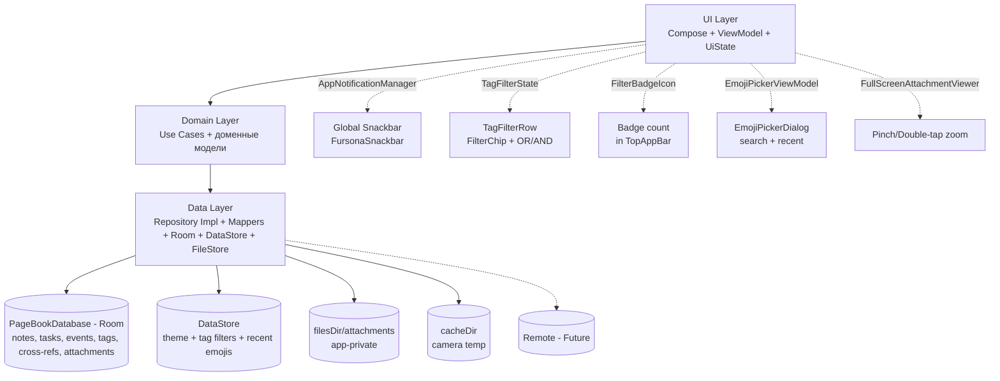

# 📱 PageBook Android

**Нативная Android-реализация** универсального органайзера с акцентом на плавность работы и Material Design! 🚀

[](https://kotlinlang.org)
[](https://developer.android.com/jetpack/compose)
[](https://developer.android.com/build/releases/gradle-plugin)
[](LICENSE)
[](CHANGELOG.md)

## 🌟 О проекте

PageBook — это нативное Android-приложение для работы со справочными материалами, заметками, задачами и календарём. Часть кроссплатформенного проекта PageBook, разрабатываемого нативно для обеих платформ.

> 📖 **iOS версия**: [PageBook iOS](https://github.com/MaxGog/PageBook-ios)

## 📖 Документация

- **[Архитектура](docs/ARCHITECTURE.md)** — подробное описание слоёв, потока данных и технических решений.
- **[Участие в разработке](docs/CONTRIBUTING.md)** — как настроить окружение, стиль кода и процесс Pull Request.
- **[История изменений](docs/CHANGELOG.md)** — что нового в каждой версии.

## ✨ Основные возможности

### 📝 Умные заметки
- Создание и редактирование заметок с rich-text форматированием
- Адаптивная сетка заметок (StaggeredGrid)
- **Вложения**: фото из галереи, **снимок с камеры** и файлы через Photo Picker / **`TakePicture`** / `OpenDocument`
- Превью вложений прямо в редакторе, **fullscreen-просмотр с pinch-to-zoom**, скачивание в `Pictures`/`Downloads`
- Создание задач прямо из заметок с автоматическим извлечением дат
- **Цветные теги с эмодзи** — палитра из 7 цветов + каталог из 200+ эмодзи
- **Поиск и недавние эмодзи** в пикере — по символу, ключевым словам (ru/en), Unicode-имени и категории; последние 20 сохраняются в `DataStore`
- **Фильтрация списка по тегам** — ряд чипов над сеткой, OR/AND-логика, «Сбросить», badge с count

### ✅ Менеджер задач
- Задачи с напоминаниями и связью с заметками
- Сортировка: незавершённые сверху, новые первыми
- Автоматическое определение даты из текста заметки (ML Kit)
- **Вложения**: те же компоненты, что и в заметках (общая подсистема), включая **камеру** и **fullscreen-viewer**
- **Цветные теги с эмодзи** — общие с заметками и календарём
- **Фильтрация по тегам** — общий компонент `TagFilterRow`

### 🗓️ Календарь и планирование
- Ежедневное планирование событий с выбором даты и времени
- Реактивное обновление при изменении событий
- Быстрый скролл к выбранной дате
- **Цветные теги с эмодзи** для категоризации событий
- **Фильтрация по тегам** — сужает и список событий, и точки-индикаторы на днях месяца

### ⚙️ Настройки и пасхалка
- Переключение темы: **System / Light / Dark** (сохраняется в `DataStore`)
- Переключение языка: **Русский / English** через `AppCompatDelegate`
- **Реактивное** применение без перезапуска приложения
- **Material 3 Expressive** дизайн: группы в карточках, пояснительный текст
- **Аватар разработчика** в разделе «О приложении»
- **Секретная пасхалка**: 7 тапов по номеру версии откроют скрытую карточку с фурсоной 🦊

### 🔔 Умные уведомления (Snackbar)
Единая глобальная система уведомлений для всего приложения:
- **Кастомный дизайн**: `FursonaSnackbar` с аватаром-фурсоной, которая элегантно выглядывает из-за края плашки.
- **Типы уведомлений**: `SUCCESS` (зелёный), `ERROR` (красный), `INFO` (серый), `EASTER_EGG` (фиолетовый).
- **Надежность**: базируется на `Channel` и `@Singleton` через Hilt (гарантирует доставку ровно один раз).
- Больше не нужно дублировать `SnackbarHost` на каждом экране — всё управляется из `MainActivity`.

### 🏷️ Сквозные теги: полный цикл
Один тег — на заметке, задаче и событии одновременно. Каждый тег можно
кастомизировать цветом (7 вариантов в стиле macOS) и **эмодзи из каталога
на 200+ штук** в 10 категориях. Реализовано через many-to-many
(junction-таблицы) в единой `PageBookDatabase`.

**Выбор эмодзи** (`EmojiPickerDialog`):
- **Поиск** — по самому символу, ключевым словам (ru/en), Unicode-имени и названию категории. Например, `"серд"` найдёт все сердца, `"работа"` — всю категорию Work.
- **Недавние** — последние 20 использованных эмодзи в `DataStore` (`RecentEmojiRepository`), дедуплицируются, свежие — первыми. Секция появляется только когда список не пуст.
- **Пустой результат** → «Эмодзи не найдены» (`no_emojis_found`).

**Фильтрация списков** на всех трёх главных экранах — `TagFilterRow`:
- **OR-логика** (по умолчанию): показываются элементы, у которых есть **хотя бы один** из выбранных тегов.
- **AND-логика**: переключается тапом на чип `OR/AND` **или долгим нажатием** на любой тег.
- **Badge с count** в `TopAppBar` — `FilterBadgeIcon` показывает число выбранных тегов; тап по нему скрывает/показывает ряд фильтров.
- **Persist**: выбранный фильтр сохраняется в `DataStore` отдельно для Notes / Tasks / Calendar и **восстанавливается после перезапуска**.
- **«Сбросить»** появляется автоматически, когда фильтр активен.
- **В календаре** фильтр сужает `datesWithEvents` — точки-индикаторы на днях автоматически пересчитываются.
- **Пустой результат** → «Ничего не найдено» (`no_matching_items`).

**Редактирование и статистика**:
- Тап на карандаш у тега в `TagPickerDialog` → `CreateTagDialog(initialTag = …)` — редактирование имени, цвета и эмодзи существующего тега.
- В диалоге редактирования показывается **счётчик использования**: `Заметок: N · Задач: N · Событий: N` (3 `COUNT(*)` по junction-таблицам).

### 📎 Вложения (Attachments)
Изображения и файлы, прикреплённые к заметкам или задачам. Общая подсистема:
- Файлы хранятся в **app-private storage** (`filesDir/attachments/`).
- **Photo Picker** (`PickVisualMedia`), **системная камера** (`TakePicture` через `FileProvider`, файл в `cacheDir`) и **`OpenDocument`** для выбора.
- **Fullscreen-просмотр** изображений с **pinch-to-zoom** (1×..5×) и **double-tap** (1× ↔ 2.5×), скачиванием из просмотра.
- Превью, удаление и экспорт в `Pictures`/`Downloads` через **MediaStore**.
- Pending-вложения для новых сущностей: файл сохраняется сразу, а `ownerId`
  проставляется после сохранения заметки/задачи.
- Для `` внутри rich-text — собственный `LocalImageLoader`,
  который читает из app-private storage (см. `AttachmentImageLoader`).

### 📱 Адаптивный UI
- **Телефоны**: `NavigationBar` + отдельные экраны
- **Планшеты / Chromebook**: `NavigationRail` + `ListDetailPaneScaffold` (два пена рядом)
- Автоматическое переключение через `WindowSizeClass`

## 🛠 Технологический стек

- **💚 100% Kotlin** — Kotlin 2.2.20
- **🎨 Jetpack Compose** — BOM 2026.09.00, Material 3 Expressive
- **💾 Room Database** — единая `PageBookDatabase` (8 entities, version 4)
- **📎 Attachments** — app-private storage + MediaStore, Photo Picker, **камера (FileProvider)**
- **📷 Camera** — системная камера через `ActivityResultContracts.TakePicture()` + `FileProvider` (`cacheDir`)
- **🖼 Fullscreen viewer** — `Dialog` fullscreen + `rememberTransformableState` (pinch/pan/double-tap)
- **🔔 Notifications** — глобальный `SnackbarHost` + `Channel` + Hilt Singleton
- **🏷️ Tag filtering** — `TagFilterRow` (`FilterChip` + `FilterMode.OR/AND`) + `TagFilterRepository` (DataStore) + `applyTagFilter` (domain util)
- **🔢 Tag usage** — `TagDao.getTagUsage(tagId)` (3 `COUNT(*)` по junction-таблицам)
- **✏️ Tag editing** — `CreateTagDialog(initialTag = …)` + `TagEditViewModel`
- **🔎 Emoji search** — `EmojiCatalog.search()` (символ / keywords ru+en / `Character.getName` / категория), `no_emojis_found`
- **🕘 Recent emojis** — `RecentEmojiRepository` (DataStore, до 20, дедуп) + `EmojiPickerViewModel` (`StateFlow`)
- **⚙️ DataStore Preferences** — хранение настроек (тема + фильтры тегов + недавние эмодзи)
- **🌐 AppCompatDelegate** — смена языка (per-app language preferences)
- **🔄 Coroutines & Flow** — реактивное программирование + `Channel` для one-shot событий
- **🧩 Hilt** — внедрение зависимостей (`@Binds` + `@Provides`)
- **🧭 Navigation Compose** — type-safe навигация + adaptive layouts
- **🤖 ML Kit Entity Extraction** — извлечение дат из текста заметок
- **📝 RichEditor** — rich-text редактор с поддержкой HTML и ``
- **📐 Material Design 3** + edge-to-edge
- **🏗 Clean Architecture** — UI / Domain / Data

## 🏗 Архитектура



### Clean Architecture
- **UI Layer**: Jetpack Compose + ViewModel + UiState (sealed interface / data class). Глобальный `Snackbar` управляется из `MainActivity` через `AppNotificationHost`. Состояние фильтра (`TagFilterState`) — часть UiState ViewModel. `EmojiPickerViewModel` изолирует логику недавних эмодзи от `CreateTagDialog`. `FullScreenAttachmentViewer` — переиспользуемый компонент, не требует отдельного экрана.
- **Domain Layer**: Use Cases, доменные модели (Note, Task, Event, Tag, TagColor, Attachment, TagFilterState, FilterMode, TagUsage), интерфейсы репозиториев (`TagFilterRepository`, `RecentEmojiRepository`), `applyTagFilter` (общая утилита).
- **Data Layer**: Room, DAO, мапперы, реализации репозиториев, DataStore (`SettingsRepository`, `TagFilterRepositoryImpl`, `RecentEmojiRepositoryImpl`), файловое хранилище (`AttachmentFileStore`, `MediaStoreDownloader`), Hilt-модули.
- **Core Layer**: `AppNotificationManager` (синглтон для событий UI).

Все три модуля — **Notes**, **Tasks**, **Calendar** — полностью на Clean Architecture.
Теги работают сквозь все три модуля через единую `PageBookDatabase`,
включая **фильтрацию** (OR/AND, persist, badge), **редактирование** и **счётчик использования**.
Вложения — полиморфная связь (`ownerType` + `ownerId`) через общую таблицу,
плюс **камера как источник** и **fullscreen-viewer** с зумом.
Эмодзи-пикер — отдельный переиспользуемый компонент с **поиском** (4 канала) и **недавними** (DataStore).

Подробнее см. в [ARCHITECTURE.md](docs/ARCHITECTURE.md).

## 🚀 Быстрый старт

### Предварительные требования
- Android Studio Otter (2026.1) или новее
- Android SDK 37 (Android 17)
- JDK 21
- Kotlin 2.2.20+

### Установка и запуск

1. **Клонируйте репозиторий**
   ```bash
   git clone https://github.com/MaxGog/PageBook-android.git
   cd PageBook-android
   ```

2. **Откройте в Android Studio**
    - File → Open → Выберите папку проекта
    - Дождитесь завершения сборки зависимостей

3. **Запустите приложение**
    - Подключите Android-устройство или запустите эмулятор
    - Нажмите ▶️ Run или `Ctrl + R`

## 📁 Структура проекта

```
app/src/main/java/ru/maxgog/pagebook/
├── core/
│   └── notification/   # AppNotification, AppNotificationManager, AppNotificationType
├── data/
│   ├── dao/            # NoteDao, TaskDao, EventDao, TagDao (+ TagUsageRow)
│   ├── local/          # AttachmentDao, AttachmentEntity
│   ├── models/         # Room-сущности (@Entity) + *WithTags (@Relation)
│   ├── rooms/          # PageBookDatabase (единая БД, version 4) + Migrations
│   ├── file/           # AttachmentFileStore, MediaStoreDownloader
│   ├── mapper/         # NoteMapper, TaskMapper, EventMapper, TagMapper,
│   │                   #   AttachmentMapper
│   ├── repository/     # *RepositoryImpl, SettingsRepository,
│   │                   #   TagFilterRepositoryImpl (DataStore),
│   │                   #   RecentEmojiRepositoryImpl (DataStore)
│   └── di/             # DatabaseModule, RepositoryModule, DataStoreModule,
│                       #   AttachmentsModule
├── domain/
│   ├── model/          # Note, Task, Event, Tag, TagColor,
│   │                   #   Attachment, AttachmentType, OwnerType,
│   │                   #   TagFilterState, FilterMode, TagFilterModule, TagUsage
│   ├── repository/     # NoteRepository, TaskRepository, EventRepository,
│   │                   #   TagRepository, TagFilterRepository,
│   │                   #   RecentEmojiRepository, AttachmentRepository (интерфейсы)
│   ├── usecase/
│   │   ├── note/       # GetAllNotesUseCase, SaveNoteUseCase, ...
│   │   ├── task/       # GetAllTasksUseCase, SaveTaskUseCase,
│   │   │               #   GetTaskByIdUseCase, CreateTaskFromNoteUseCase, ...
│   │   ├── event/      # GetAllEventsUseCase, SaveEventUseCase, ...
│   │   ├── tag/        # GetAllTagsUseCase, CreateTagUseCase, UpdateTagUseCase,
│   │   │               #   DeleteTagUseCase, GetTagUsageUseCase,
│   │   │               #   GetTagsFor{Note,Task,Event}UseCase,
│   │   │               #   ToggleTagOn{Note,Task,Event}UseCase
│   │   └── attachment/ # SaveAttachmentUseCase, DeleteAttachmentUseCase,
│   │                   #   DownloadAttachmentUseCase,
│   │                   #   GetAttachmentsFor{Note,Task}UseCase
│   └── util/           # TagFilterExt.kt (applyTagFilter — OR/AND)
├── ui/
│   ├── app/            # CombinedApp, MainViewModel
│   ├── navigation/     # Destinations, AppNavHost, BottomNavBar
│   ├── notification/   # AppNotificationHost, FursonaSnackbar, FursonaSnackbarVisuals
│   ├── components/     # TagChip (onEdit/onLongClick), CompactTagChip,
│   │                   #   CreateTagDialog (create/edit + usage),
│   │                   #   TagPickerDialog (onEditTag),
│   │                   #   TagFilterRow (+mode toggle),
│   │                   #   FilterBadgeIcon, TagEditViewModel,
│   │                   #   EmojiCatalog (+keywords + search()), EmojiPickerDialog,
│   │                   #   EmojiPickerViewModel (recent emojis),
│   │                   #   OverflowMenu, AttachmentPreviewList,
│   │                   #   AttachmentImageLoader, AttachmentPicker,
│   │                   #   CameraPicker (TakePicture + FileProvider),
│   │                   #   FullScreenAttachmentViewer (pinch/double-tap zoom),
│   │                   #   ResizeImageDialog
│   ├── notes/          # NotesScreen, NoteEditScreen + ViewModels + UiStates + NoteItem
│   ├── tasks/          # TaskListScreen, TaskEditScreen, TaskItem,
│   │                   #   TaskListDetailPane + ViewModels + UiStates
│   ├── calendar/       # CalendarScreen, AddEventDialog, DateTimePickerDialog,
│   │                   #   EventItem, CalendarViewModel
│   ├── settings/       # SettingsScreen, SettingsViewModel, AppLanguage,
│   │                   #   ThemePreference, LanguagePreference, SettingsGroup,
│   │                   #   FursonaEasterEgg
│   └── theme/          # Color, Type, Theme, AppTheme (enum ThemeMode)
├── Converters.kt       # LocalDate ↔ String + toKotlinxLocalDate()
├── PageBookApplication.kt
└── MainActivity.kt

app/src/main/res/xml/
└── file_paths.xml      # FileProvider paths (cache-path для камеры)
```

## 🧩 Функциональные возможности

| Модуль               | Возможности                                                                                                                                       | Технологии                                     |
|----------------------|---------------------------------------------------------------------------------------------------------------------------------------------------|------------------------------------------------|
| **Notes** 📝         | Rich-text заметки, адаптивная сетка, ML Kit для извлечения дат, **теги с эмодзи**, **фильтрация по тегам (OR/AND, persist, badge)**, **вложения (галерея + камера + файлы)**, **fullscreen-viewer** | Compose, Room, RichEditor, ML Kit, PhotoPicker, TakePicture |
| **Tasks** ✅         | Задачи с напоминаниями, связь с заметками (`noteId`), сортировка, **теги с эмодзи**, **фильтрация по тегам**, **вложения (галерея + камера + файлы)**, **fullscreen-viewer** | Compose, StateFlow, Room                       |
| **Calendar** 🗓️      | События по датам, реактивное обновление, автоскролл, **теги с эмодзи**, **фильтрация (список + точки на днях)**                                   | Compose, kizitonwose Calendar, Room            |
| **Settings** ⚙️      | Тема (System/Light/Dark), язык (ru/en), **пасхалка с фурсоной**, **аватар разработчика**                                                          | Compose, DataStore, AppCompat                  |
| **Notifications** 🔔 | Глобальные уведомления (SUCCESS/ERROR/INFO/EASTER_EGG) с аватаром-фурсоной, выходящим за края `Snackbar`                                          | Compose, Channel, Hilt                         |
| **Tags** 🏷️          | Сквозные теги: 7 цветов macOS + **200+ эмодзи**, **фильтр OR/AND + persist + badge**, **редактирование**, **счётчик использования**               | Room (@Relation + @Junction), Hilt, FilterChip |
| **Emoji picker** 🔎  | Каталог 200+ эмодзи в 10 категориях, **поиск** (символ / keywords ru+en / Unicode-имя / категория), **недавние** (20, DataStore)                   | Compose, DataStore, Hilt, `Character.getName`  |
| **Attachments** 📎   | App-private storage + MediaStore, Photo Picker + **TakePicture (FileProvider)**, **fullscreen-viewer с pinch/double-tap**, `@Update` для pending, `` в rich-text | Room, ContentResolver, FileProvider, LocalImageLoader |
| **Camera** 📷        | Системная камера через `TakePicture` + `FileProvider` (cacheDir), без `CAMERA`-permission                                                          | ActivityResultContracts, FileProvider          |

## 🏷️ Фильтрация по тегам

Единый UX во всех трёх модулях:
- **`TagFilterRow`** — горизонтальный `LazyRow`:
    - слева — `AssistChip` режима **`OR`/`AND`** (тап — переключение);
    - далее — `FilterChip` (`TagChip` с `selected = true`), **долгое нажатие** на любой тег тоже переключает режим;
    - в конце — `AssistChip` «Сбросить», когда фильтр активен.
- **`FilterBadgeIcon`** в `TopAppBar` — `BadgedBox` с `count` выбранных тегов. Тап скрывает/показывает ряд фильтров (экономит вертикальное место, когда фильтр не активен).
- **`TagFilterState(tagIds, mode)`** в Domain — тип-безопасное представление фильтра.
- **`TagFilterRepository`** (DataStore) — **persist** фильтра отдельно для каждого модуля (`NOTES`/`TASKS`/`CALENDAR`); восстанавливается после перезапуска.
- **`applyTagFilter`** (`domain/util/TagFilterExt.kt`) — общая утилита OR/AND, тестируется один раз.
- **В календаре** фильтр сужает `datesWithEvents` — точки-индикаторы на днях автоматически пересчитываются (заодно исправлен баг: раньше точка была только у выбранного дня).
- **Пустой результат** → «Ничего не найдено» (`no_matching_items`) вместо «Нет заметок/задач/событий».

Логика фильтрации вынесена во ViewModel (`filterState: StateFlow<TagFilterState>` + `combine`) — UI не знает о тегах ничего, кроме ID; фильтрация в памяти, без дополнительных DAO-запросов.

## ✏️ Редактирование тегов и счётчик использования

- **`CreateTagDialog(initialTag = …)`** работает в двух режимах:
    - **создание** — `new_tag` / `create`;
    - **редактирование** — `edit_tag` / `save`, плюс строка **usage** `Заметок: N · Задач: N · Событий: N`.
- **`TagEditViewModel`** (`@HiltViewModel`) — отдельный от экрана; при `initialTag != null` подгружает `TagUsage` через `GetTagUsageUseCase` и отдаёт в диалог.
- **`TagChip.onEdit`** — иконка карандаша в `trailingIcon` (показывается только если передан колбэк).
- **`TagPickerDialog.onEditTag`** — опциональный колбэк, открывает диалог редактирования поверх пикера.
- **`TagDao.getTagUsage(tagId)`** — один SQL-запрос с 3 `COUNT(*)` по junction-таблицам `note_tag_cross_ref` / `task_tag_cross_ref` / `event_tag_cross_ref`.

## 🔎 Emoji picker: поиск и недавние

`EmojiPickerDialog` (`ui/components/`) — общий компонент выбора эмодзи
(сейчас используется в `CreateTagDialog`), с двумя новыми фичами поверх
каталога по категориям.

### Поиск
- Строка `OutlinedTextField` вверху диалога. Пока она не пуста —
  категории-чипы и «Недавние» **скрываются**, показывается только сетка результатов.
- `EmojiCatalog.search(query, categoryNames)` — чистая функция, 4 канала матчинга:
    1. **Сам символ** — вставьте `🎯` руками;
    2. **Ключевые слова** `ru/en` из `Map<String, List<String>> keywords` — `"серд"` → все сердца, `"работа"` → 💼;
    3. **Unicode-имя** через `Character.getName(codePoint)` — fallback, покрывает даже те эмодзи, для которых нет ключевых слов (`"grinning"`, `"face"`);
    4. **Название категории** — `categoryNames` (уже локализованы через `stringResource`) → запрос `"работа"` тянет всю категорию Work.
- **Пустой результат** → `no_emojis_found` («Эмодзи не найдены»).

### Недавние
- **`RecentEmojiRepository`** (`@Singleton`, DataStore Preferences) — `Flow<List<String>>` + `addRecentEmoji(emoji)`.
- Ключ `recent_emojis`, разделитель `|` (безопасен для эмодзи), **до 20** записей, **дедупликация** (выбранный — в начало).
- **`EmojiPickerViewModel`** (`@HiltViewModel`) — `recentEmojis: StateFlow<List<String>>` (WhileSubscribed(5_000)).
- При выборе любого эмодзи (из «Недавних», категории или поиска) — `viewModel.onEmojiSelected(emoji)` **перед** `onEmojiSelected(...)`, поэтому список обновится к следующему открытию.
- Секция «Недавние» рендерится **только когда список не пуст** — не засоряет UI у нового пользователя.

## 📷 Камера и 🖼 fullscreen-просмотр

### Камера
- **Пункт «Сделать фото»** в `DropdownMenu` `showMoreMenu` у `NoteEditScreen` и `TaskEditScreen`.
- **`rememberCameraPicker`** (`ui/components/CameraPicker.kt`) — обёртка над `ActivityResultContracts.TakePicture()`.
- Снимок пишется в **`cacheDir/camera_<timestamp>.jpg`**, отдаётся системной камере через **`FileProvider`** (`authority = "${packageName}.fileprovider"`).
- После успеха `onPicked(contentUri)` → `viewModel.attachUri(uri)` → `SaveAttachmentUseCase` копирует в `filesDir/attachments/`. Кэш-файл вычищается системой.
- **Разрешение `CAMERA` не требуется** — `ACTION_IMAGE_CAPTURE` выполняет отдельное приложение камеры.

### Fullscreen-viewer
- **`FullScreenAttachmentViewer`** (`ui/components/FullScreenAttachmentViewer.kt`) — `Dialog(usePlatformDefaultWidth = false, decorFitsSystemWindows = false)` на весь экран.
- **pinch-to-zoom** (1×..5×) и панорамирование двумя пальцами через `rememberTransformableState`; при `scale == 1×` offset сбрасывается в `Offset.Zero`.
- **double-tap** — 1× ↔ 2.5× через `detectTapGestures(onDoubleTap = …)`.
- **Верхняя панель** (`Surface` + `windowInsetsPadding(WindowInsets.statusBars)`): закрыть, имя файла, скачать (тот же `downloadAttachment` из ViewModel).
- **Вызов:** `AttachmentPreviewList` принимает `onImageClick: ((Attachment) -> Unit)? = null` — тап по картинке открывает viewer, тап по крестику/скачиванию выполняет соответствующее действие.

## 🔔 Система уведомлений

Мы отказались от локальных `SnackbarHost` на каждом экране в пользу единого глобального менеджера:
- **`AppNotificationManager`** (`@Singleton`) — инжектится в ViewModel и позволяет отправлять сообщения через `notificationManager.success(R.string...)` или `.error(...)`.
- **`FursonaSnackbar`** — кастомный UI, реализованный через `Box` + `Surface`. Фурсона позиционируется `BottomStart` с отрицательным `offset`, что позволяет ей красиво выглядывать за пределы плашки, не перекрывая текст.
- **`AppNotificationHost`** — вешается один раз в `MainActivity`, собирает события из `Channel` и отображает их с помощью `SnackbarHostState`.

## 🛠 Разработка

### Сборка проекта
```bash
./gradlew assembleDebug
```

### Тестирование
```bash
./gradlew test
```

### Анализ кода
```bash
./gradlew ktlintCheck
```

Полный гайд по настройке окружения и процессу PR — в [CONTRIBUTING.md](docs/CONTRIBUTING.md).

## 🤝 Участие в разработке

Мы рады контрибьюторам! Кратко:

- **🐛 Баги** — создайте [Issue](https://github.com/MaxGog/PageBook-android/issues) с шагами воспроизведения.
- **💡 Идеи** — откройте Issue с меткой `enhancement`.
- **🔧 Pull Requests** — следуйте процессу из [CONTRIBUTING.md](docs/CONTRIBUTING.md).
- **🏷️ Good First Issues** — начните с задач с этой меткой.

## 🎯 Планы развития

- [x] **Clean Architecture** для всех модулей (Notes, Tasks, Calendar)
- [x] **Type-safe navigation** через `@Serializable` destinations
- [x] **Hilt** для внедрения зависимостей (`@Binds` + `@Provides`)
- [x] **ML Kit** для извлечения дат из заметок
- [x] **Единая PageBookDatabase** с `ForeignKey` между сущностями
- [x] **Сквозные теги** (7 цветов, many-to-many) во всех модулях
- [x] **DataStore** для настроек (тема)
- [x] **Эмодзи-кастомизация тегов** (200+ эмодзи в 10 категориях)
- [x] **Фильтрация списков по тегам** в Notes / Tasks / Calendar (`TagFilterRow`, OR-логика, «Сбросить», точки в календаре)
- [x] **Сохранение фильтра** между перезапусками — `TagFilterRepository` (DataStore) для каждого модуля
- [x] **AND-логика фильтра** — `FilterMode.OR/AND`, long-press на теге + `AssistChip`
- [x] **Счётчик выбранных тегов** в `TopAppBar` — `FilterBadgeIcon` + `Badge`
- [x] **Редактирование существующих тегов** — `CreateTagDialog(initialTag = …)`, `TagPickerDialog.onEditTag`, `TagEditViewModel`
- [x] **Счётчик использования тега** — `TagDao.getTagUsage(tagId)` в диалоге редактирования
- [x] **Поиск по эмодзи** в `EmojiPickerDialog` — `EmojiCatalog.search()`, 4 канала (символ / keywords ru+en / Unicode-имя / категория)
- [x] **Недавние эмодзи** — `RecentEmojiRepository` (DataStore, до 20, дедуп), `EmojiPickerViewModel`, секция «Недавние»
- [x] **UI для создания задач из заметок** 🤖 (кнопка `AddTask` в `NoteEditScreen`)
- [x] **Material 3 Expressive** (настройки, карточки, `OverflowMenu`)
- [x] **Адаптивный UI** (`NavigationSuiteScaffold`, `ListDetailPaneScaffold`)
- [x] **Смена языка** через `AppCompatDelegate` (единый источник правды)
- [x] **One-Shot Events** через `Channel` для навигации
- [x] **Вложения** для Notes и Tasks (фото + файлы, MediaStore-экспорт, pending)
- [x] **Камера как источник изображения** — `rememberCameraPicker` (`TakePicture` + `FileProvider`), пункт «Сделать фото» в редакторах
- [x] **Fullscreen-просмотр вложений** — `FullScreenAttachmentViewer` (pinch-to-zoom, double-tap, скачивание), `AttachmentPreviewList.onImageClick`
- [x] **Глобальная система уведомлений** (кастомный `Snackbar` с фурсоной)
- [x] **Пасхалка** (7 тапов по версии) и аватар разработчика в настройках
- [x] **Смена языка на Android < 13** (требуется `AppCompatActivity`)
- [ ] **Мультиверсионные заметки для соцсетей** — одна заметка с несколькими
  «адаптациями» под разные платформы. Сценарий для художника: написал
  пост в заметке → переключился на версию для другой соцсети и слегка
  подправил текст/форматирование/вложения под её формат.
- [ ] **`ListDetailPaneScaffold` для Notes и Calendar** (аналогично Tasks)
- [ ] **`MIGRATION_3_4`** для `attachments` (сейчас `fallbackToDestructiveMigration`)
- [ ] **Синхронизация с облаком** ☁️
- [ ] **Виджеты для главного экрана** 🏠
- [ ] **Резервное копирование** 💾
- [ ] **Голосовые заметки** 🎤
- [ ] **Модуляризация** (feature-модули)
- [ ] **Unit-тесты** для Use Cases и Repository (включая `AttachmentRepository`, `applyTagFilter`, `TagFilterRepositoryImpl`, `EmojiCatalog.search`, `RecentEmojiRepositoryImpl`)
- [ ] **WorkManager** для напоминаний о задачах
- [ ] **Kotlin Multiplatform** для общей бизнес-логики

## 📄 Лицензия

Этот проект распространяется под лицензией **GNU Affero General Public License v3.0 (AGPL-3.0)**. Подробнее см. в файле [GNU AFFERO GENERAL PUBLIC.txt](GNU%20AFFERO%20GENERAL%20PUBLIC.txt) или на [официальном сайте FSF](https://www.gnu.org/licenses/agpl-3.0.html).

## 👨‍💻 Автор

**MaxGog**
- GitHub: [@MaxGog](https://github.com/MaxGog)

## 💬 Обратная связь

Есть вопросы или предложения? Не стесняйтесь:
- Создать [Issue](https://github.com/MaxGog/PageBook-android/issues)
- Написать в Discussions