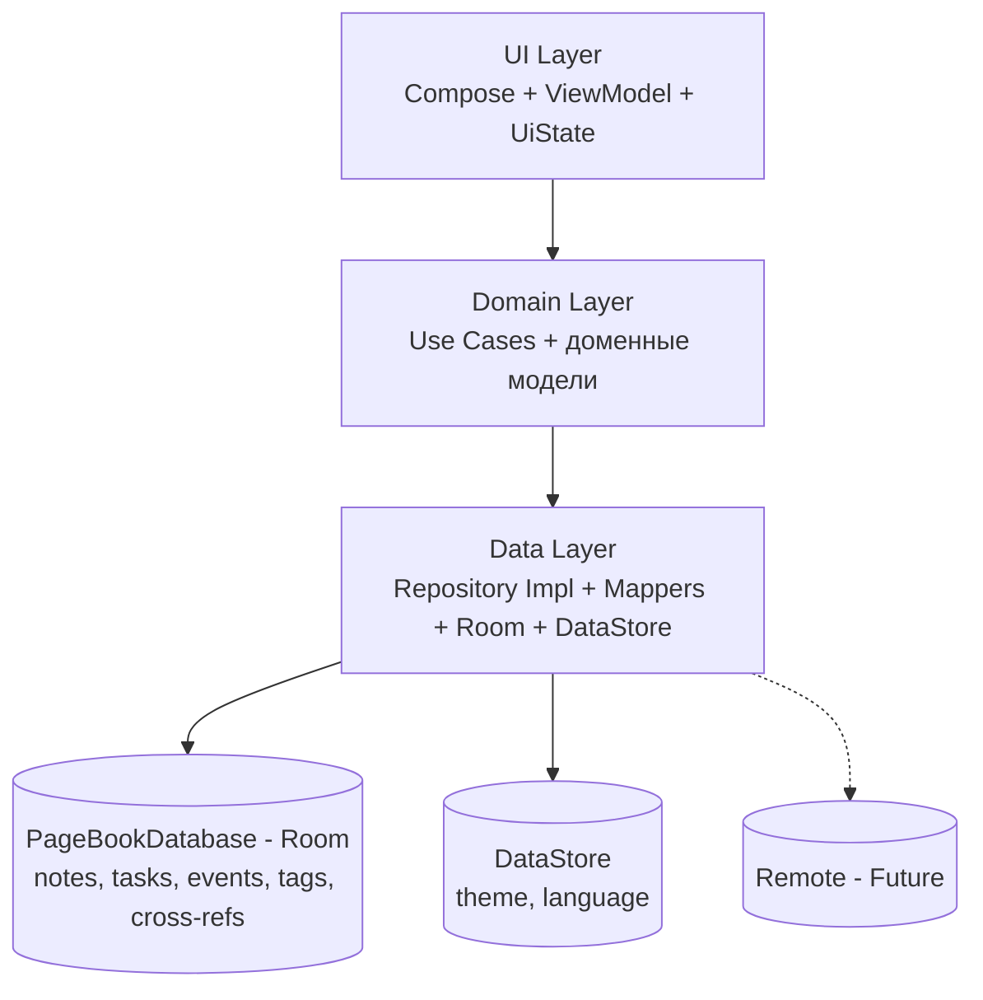

# 📱 PageBook Android

**Нативная Android-реализация** универсального органайзера с акцентом на плавность работы и Material Design! 🚀

[](https://kotlinlang.org)
[](https://developer.android.com/jetpack/compose)
[](https://developer.android.com/build/releases/gradle-plugin)
[](LICENSE)
[](CHANGELOG.md)

## 🌟 О проекте

PageBook — это нативное Android-приложение для работы со справочными материалами, заметками, задачами и календарём. Часть кроссплатформенного проекта PageBook, разрабатываемого нативно для обеих платформ.

> 📖 **iOS версия**: [PageBook iOS](https://github.com/MaxGog/PageBook-ios)

## 📖 Документация

- **[Архитектура](docs/ARCHITECTURE.md)** — подробное описание слоёв, потока данных и технических решений.
- **[Участие в разработке](docs/CONTRIBUTING.md)** — как настроить окружение, стиль кода и процесс Pull Request.
- **[История изменений](docs/CHANGELOG.md)** — что нового в каждой версии.

## ✨ Основные возможности

### 📝 Умные заметки
- Создание и редактирование заметок с rich-text форматированием
- Адаптивная сетка заметок (StaggeredGrid)
- Создание задач прямо из заметок с автоматическим извлечением дат
- **Цветные теги с эмодзи** — палитра из 7 цветов + каталог из 200+ эмодзи

### ✅ Менеджер задач
- Задачи с напоминаниями и связью с заметками
- Сортировка: незавершённые сверху, новые первыми
- Автоматическое определение даты из текста заметки (ML Kit)
- **Цветные теги с эмодзи** — общие с заметками и календарём

### 🗓️ Календарь и планирование
- Ежедневное планирование событий с выбором даты и времени
- Реактивное обновление при изменении событий
- Быстрый скролл к выбранной дате
- **Цветные теги с эмодзи** для категоризации событий

### ⚙️ Настройки
- Переключение темы: **System / Light / Dark** (сохраняется в `DataStore`)
- Переключение языка: **Русский / English** через `AppCompatDelegate`
- **Реактивное** применение без перезапуска приложения

### 🏷️ Сквозные теги с эмодзи
Один тег — на заметке, задаче и событии одновременно. Каждый тег можно
кастомизировать цветом (7 вариантов в стиле macOS) и **эмодзи из каталога
на 200+ штук** в 10 категориях. Реализовано через many-to-many
(junction-таблицы) в единой `PageBookDatabase`.

## 🛠 Технологический стек

- **💚 100% Kotlin** — Kotlin 2.2.20
- **🎨 Jetpack Compose** — BOM 2026.09.00, Material 3 Expressive
- **💾 Room Database** — единая `PageBookDatabase` (7 entities, version 3)
- **⚙️ DataStore Preferences** — хранение настроек (тема, язык)
- **🔄 Coroutines & Flow** — реактивное программирование
- **🧩 Hilt** — внедрение зависимостей (`@Binds` + `@Provides`)
- **🧭 Navigation Compose** — type-safe навигация через `@Serializable` destinations
- **🤖 ML Kit Entity Extraction** — извлечение дат из текста заметок
- **📐 Material Design 3** + edge-to-edge
- **🏗 Clean Architecture** — UI / Domain / Data

## 🏗 Архитектура



### Clean Architecture
- **UI Layer**: Jetpack Compose + ViewModel + UiState (sealed interface / data class)
- **Domain Layer**: Use Cases, доменные модели (Note, Task, Event, Tag, TagColor), интерфейсы репозиториев
- **Data Layer**: Room, DAO, мапперы, реализации репозиториев, DataStore, Hilt-модули

Все три модуля — **Notes**, **Tasks**, **Calendar** — полностью на Clean Architecture.
Теги работают сквозь все три модуля через единую `PageBookDatabase`.

Подробнее см. в [ARCHITECTURE.md](docs/ARCHITECTURE.md).

## 🚀 Быстрый старт

### Предварительные требования
- Android Studio Otter (2026.1) или новее
- Android SDK 37 (Android 17)
- JDK 21
- Kotlin 2.2.20+

### Установка и запуск

1. **Клонируйте репозиторий**
   ```bash
   git clone https://github.com/MaxGog/PageBook-android.git
   cd PageBook-android
   ```

2. **Откройте в Android Studio**
   - File → Open → Выберите папку проекта
   - Дождитесь завершения сборки зависимостей

3. **Запустите приложение**
   - Подключите Android-устройство или запустите эмулятор
   - Нажмите ▶️ Run или `Ctrl + R`

## 📁 Структура проекта

```
app/src/main/java/ru/maxgog/pagebook/
├── data/
│   ├── dao/            # NoteDao, TaskDao, EventDao, TagDao
│   ├── models/         # Room-сущности (@Entity) + *WithTags (@Relation)
│   ├── rooms/          # PageBookDatabase (единая БД) + Migrations
│   ├── mapper/         # NoteMapper, TaskMapper, EventMapper, TagMapper
│   ├── repository/     # *RepositoryImpl, SettingsRepository (DataStore)
│   └── di/             # DatabaseModule, RepositoryModule, DataStoreModule
├── domain/
│   ├── model/          # Note, Task, Event, Tag, TagColor
│   ├── repository/     # NoteRepository, TaskRepository, EventRepository,
│   │                   #   TagRepository (интерфейсы)
│   └── usecase/
│       ├── note/       # GetAllNotesUseCase, SaveNoteUseCase, ...
│       ├── task/       # GetAllTasksUseCase, SaveTaskUseCase,
│       │               #   GetTaskByIdUseCase, CreateTaskFromNoteUseCase, ...
│       ├── event/      # GetAllEventsUseCase, SaveEventUseCase, ...
│       └── tag/        # GetAllTagsUseCase, CreateTagUseCase, UpdateTagUseCase,
│                       #   DeleteTagUseCase, GetTagsFor{Note,Task,Event}UseCase,
│                       #   ToggleTagOn{Note,Task,Event}UseCase
├── ui/
│   ├── app/            # CombinedApp (корневой Scaffold)
│   ├── navigation/     # Destinations, AppNavHost, BottomNavBar
│   ├── components/     # TagChip, CompactTagChip, CreateTagDialog,
│   │                   #   TagPickerDialog, EmojiCatalog, EmojiPickerDialog
│   ├── notes/          # NotesScreen, NotesViewModel, NotesUiState, NoteItem
│   ├── note_edit/      # NoteEditScreen, NoteEditViewModel, NoteEditUiState
│   ├── tasks/          # TaskListScreen, TaskEditScreen, TaskItem,
│   │                   #   TaskListViewModel, TaskEditViewModel
│   ├── calendar/       # CalendarScreen, AddEventDialog, DateTimePickerDialog,
│   │                   #   EventItem, CalendarViewModel
│   ├── settings/       # SettingsScreen, SettingsViewModel,
│   │                   #   ThemePreference, LanguagePreference, SettingsSection
│   └── theme/          # Color, Type, Theme, AppTheme (enum ThemeMode)
├── Converters.kt
├── PageBookApplication.kt
└── MainActivity.kt
```

## 🧩 Функциональные возможности

| Модуль          | Возможности                                                                         | Технологии                          |
|-----------------|-------------------------------------------------------------------------------------|-------------------------------------|
| **Notes** 📝    | Rich-text заметки, адаптивная сетка, ML Kit для извлечения дат, **теги с эмодзи**   | Compose, Room, RichEditor, ML Kit   |
| **Tasks** ✅    | Задачи с напоминаниями, связь с заметками (`noteId`), сортировка, **теги с эмодзи** | Compose, StateFlow, Room            |
| **Calendar** 🗓️ | События по датам, реактивное обновление, автоскролл, **теги с эмодзи**              | Compose, kizitonwose Calendar, Room |
| **Settings** ⚙️ | Тема (System/Light/Dark), язык (ru/en) через DataStore                              | Compose, DataStore, AppCompat       |
| **Tags** 🏷️     | Сквозные теги: 7 цветов macOS + **200+ эмодзи** в 10 категориях                     | Room (@Relation + @Junction), Hilt  |

## 🏷️ Система тегов

Теги — **сквозная фича** приложения. Один тег может быть привязан
к заметке, задаче и событию одновременно. Каждый тег кастомизируется
цветом и эмодзи.

| Слой       | Компоненты                                                                                                                                   |
|:-----------|:---------------------------------------------------------------------------------------------------------------------------------------------|
| **Domain** | `Tag` (id, name, colorHex, **emoji: String?**), `TagColor` (7 цветов macOS), 10 Use Cases в `usecase/tag/`                                   |
| **Data**   | `TagModel` (+ колонка `Emoji`), 3 junction-таблицы (`NoteTagCrossRef`, `TaskTagCrossRef`, `EventTagCrossRef`), `TagDao`, `TagRepositoryImpl` |
| **UI**     | `TagChip`, `CompactTagChip`, `CreateTagDialog`, `TagPickerDialog`, **`EmojiCatalog`** (200+ эмодзи), **`EmojiPickerDialog`**                 |

### Кастомизация тега

| Параметр     | Варианты                                                                                                                | Где задаётся        |
|:-------------|:------------------------------------------------------------------------------------------------------------------------|:--------------------|
| **Цвет**     | 7 цветов: 🔴 Красный · 🟠 Оранжевый · 🟡 Жёлтый · 🟢 Зелёный · 🔵 Синий · 🟣 Фиолетовый · ⚫ Серый                      | `CreateTagDialog`   |
| **Эмодзи**   | 200+ эмодзи в 10 категориях (Смайлы, Работа, Идеи, Учёба, Дом, Еда, Природа, Спорт, Путешествия, Символы) — опционально | `EmojiPickerDialog` |
| **Название** | любая строка (trim, непустая)                                                                                           | `CreateTagDialog`   |

**Отображение:**
- **`TagChip`** (редакторы, picker) — если эмодзи задан, показывается вместо цветной точки в `leadingIcon`.
- **`CompactTagChip`** (карточки в списках) — эмодзи идёт перед названием: `"🎯 Цели"`.

## 🛠 Разработка

### Сборка проекта
```bash
./gradlew assembleDebug
```

### Тестирование
```bash
./gradlew test
```

### Анализ кода
```bash
./gradlew ktlintCheck
```

Полный гайд по настройке окружения и процессу PR — в [CONTRIBUTING.md](docs/CONTRIBUTING.md).

## 🤝 Участие в разработке

Мы рады контрибьюторам! Кратко:

- **🐛 Баги** — создайте [Issue](https://github.com/MaxGog/PageBook-android/issues) с шагами воспроизведения.
- **💡 Идеи** — откройте Issue с меткой `enhancement`.
- **🔧 Pull Requests** — следуйте процессу из [CONTRIBUTING.md](docs/CONTRIBUTING.md).
- **🏷️ Good First Issues** — начните с задач с этой меткой.

## 🎯 Планы развития

- [x] **Clean Architecture** для всех модулей (Notes, Tasks, Calendar)
- [x] **Type-safe navigation** через `@Serializable` destinations
- [x] **Hilt** для внедрения зависимостей (`@Binds` + `@Provides`)
- [x] **ML Kit** для извлечения дат из заметок
- [x] **Единая PageBookDatabase** с `ForeignKey` между сущностями
- [x] **Сквозные теги** (7 цветов, many-to-many) во всех модулях
- [x] **DataStore** для настроек (тема + язык)
- [x] **Эмодзи-кастомизация тегов** (200+ эмодзи в 10 категориях)
- [ ] **UI для создания задач из заметок** 🤖
- [ ] **Фильтрация списков по тегам** в Notes / Tasks / Calendar
- [ ] **Редактирование существующих тегов** (имя/цвет/эмодзи)
- [ ] **Счётчик использования тега** (сколько заметок/задач/событий)
- [ ] **Поиск по эмодзи** в `EmojiPickerDialog`
- [ ] **Недавние эмодзи** (последние 20 в `DataStore`)
- [ ] **Синхронизация с облаком** ☁️
- [ ] **Виджеты для главного экрана** 🏠
- [ ] **Резервное копирование** 💾
- [ ] **Голосовые заметки** 🎤
- [ ] **Модуляризация** (feature-модули)
- [ ] **Unit-тесты** для Use Cases и Repository
- [ ] **WorkManager** для напоминаний о задачах
- [ ] **Kotlin Multiplatform** для общей бизнес-логики

## 👨‍💻 Автор

**MaxGog**
- GitHub: [@MaxGog](https://github.com/MaxGog)

## 💬 Обратная связь

Есть вопросы или предложения? Не стесняйтесь:
- Создать [Issue](https://github.com/MaxGog/PageBook-android/issues)
- Написать в Discussions