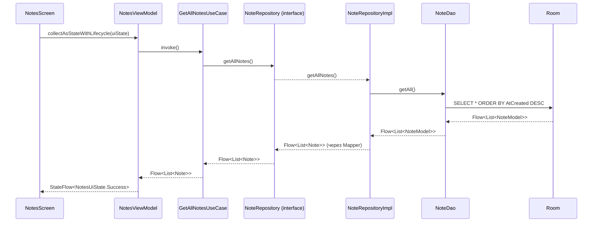

# 🏗 Архитектура PageBook Android

## 🎯 Обзор

PageBook Android следует официальным рекомендациям Google по архитектуре
приложений и использует **Clean Architecture** с тремя слоями:

- **UI Layer** — Compose + ViewModel + UI State.
- **Domain Layer** — Use Cases, доменные модели, интерфейс репозитория.
- **Data Layer** — Room, DAO, реализация репозитория, мапперы.

Внедрение зависимостей — **Hilt** (`@HiltAndroidApp`, `@HiltViewModel`, модули в `data/di/`).

Навигация — **type-safe** на основе `@Serializable` destinations (Navigation Compose 2.8+).

> **Статус миграции:** Clean Architecture полностью внедрена для модуля **Notes**.
> Модули **Todos** и **Events** пока используют упрощённую схему (ViewModel → Repository → DAO)
> и будут переведены в следующих итерациях.

## 🛠 Технологический стек

| Компонент | Технология | Версия |
| :--- | :--- | :--- |
| Язык | Kotlin | 2.2.20 |
| UI | Jetpack Compose + Material 3 | BOM 2026.09.00 |
| Архитектура | Clean Architecture (UI/Domain/Data) | — |
| Локальное хранилище | Room | 2.7.2 |
| Асинхронность | Coroutines & Flow | 1.10.2 |
| DI | **Hilt** | 2.56.2 |
| Навигация | Navigation Compose (type-safe) | 2.9.0 |
| Сборка | AGP | 9.4.1 |
| SDK | compileSdk 37 / targetSdk 36 / minSdk 28 | — |
| JDK | Java 21 | — |

## 📂 Структура пакетов

```
ru.maxgog.pagebook
├── PageBookApplication.kt        # @HiltAndroidApp
├── MainActivity.kt               # enableEdgeToEdge() + setContent { CombinedAppTheme { ... } }
│
├── data/
│   ├── dao/                      # Room DAO (NoteDao, TodoDao, EventDao)
│   ├── models/                   # Room-сущности (@Entity)
│   ├── rooms/                    # RoomDatabase (Singleton)
│   ├── mapper/                   # Note ↔ NoteModel
│   ├── repository/               # Реализации доменных интерфейсов (NoteRepositoryImpl)
│   └── di/                       # Hilt-модули (NotesModule, TodoModule, EventModule)
│
├── domain/
│   ├── model/                    # Чистые модели (Note)
│   ├── repository/               # Интерфейсы репозиториев (NoteRepository)
│   └── usecase/                  # GetAllNotesUseCase, SaveNoteUseCase, ...
│
└── ui/
    ├── app/                      # CombinedApp — корневой Composable со Scaffold
    ├── navigation/               # Destinations.kt, AppNavHost.kt, BottomNavBar.kt
    ├── notes/                    # NotesScreen, NotesViewModel, NotesUiState
    ├── note_edit/                # NoteEditScreen, NoteEditViewModel, NoteEditUiState
    ├── screens/                  # TodoScreen, CalendarScreen, SettingsScreen
    ├── items/                    # NoteItem, TodoItem, EventItem
    └── theme/                    # Color, Type, Theme
```

## 🔄 Поток данных (пример: список заметок)



**Запись (создание/сохранение заметки):** `NoteEditScreen` → `NoteEditViewModel.save()` →
`SaveNoteUseCase` (решает insert или update по `id == 0`) → `NoteRepository.updateNote/insertNote` →
`NoteDao` → Room.

## 🧭 Ключевые архитектурные решения

| Решение | Обоснование |
| :--- | :--- |
| **Clean Architecture** | UI не зависит от схемы БД; Use Cases инкапсулируют бизнес-логику; легко тестировать. |
| **Repository как интерфейс** | Позволяет подменить источник данных (например, добавить сеть) без изменения Domain/UI. |
| **UI State (sealed interface)** | Явные состояния `Loading`/`Success`/`Error` — не «дёргающийся» UI и предсказуемое поведение. |
| **Hilt** | Масштабируемый DI, генерируемый на этапе компиляции, интеграция с `@HiltViewModel`. |
| **Type-safe navigation** | Компилятор проверяет маршруты и аргументы; безопасный рефакторинг. |
| **`collectAsStateWithLifecycle()`** | Подписка живёт только пока экран видим — экономия ресурсов. |
| **`contentPadding` в LazyColumn/Grid** | Правильный edge-to-edge: контент прокручивается под барами. |

## 🚀 Планы по развитию

- [x] Внедрить **Hilt** для DI.
- [x] Выделить **Domain Layer** (Use Cases) для заметок.
- [ ] Перенести **Todos** и **Events** на Clean Architecture.
- [ ] Добавить **отдельные Domain-модели** для Todos и Events.
- [ ] Настроить **модуляризацию** (feature-модули) для ускорения сборки.
- [ ] Unit-тесты для Use Cases и Repository.

## 📚 Полезные ссылки

- [Guide to App Architecture (Google)](https://developer.android.com/topic/architecture)
- [Now in Android (официальный референс)](https://github.com/android/nowinandroid)
- [Navigation — type safety](https://developer.android.com/guide/navigation/design/type-safety)