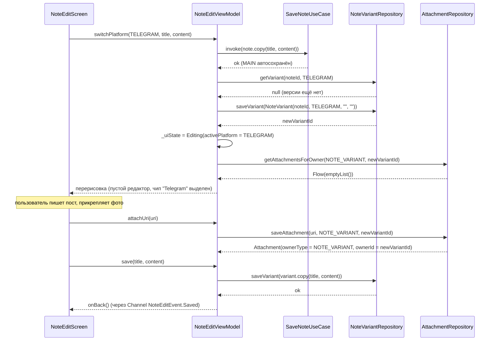
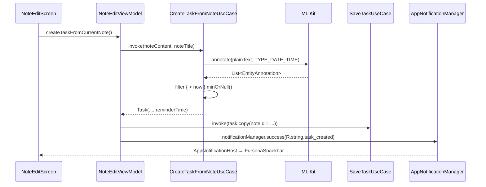
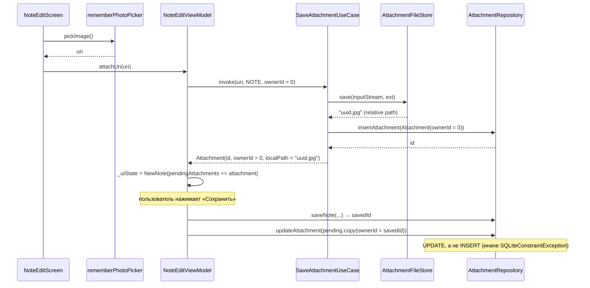
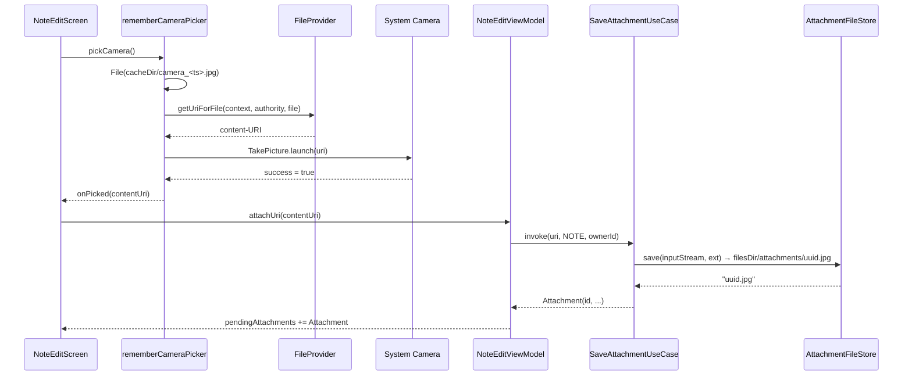
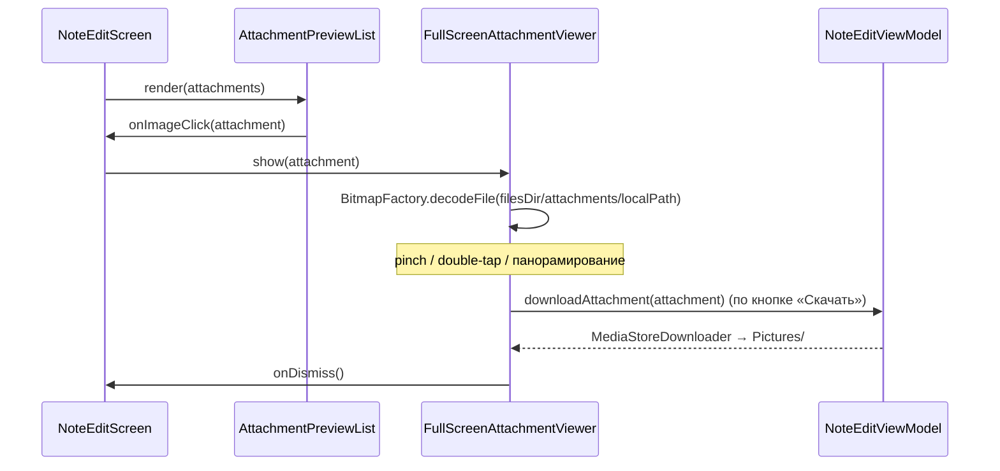
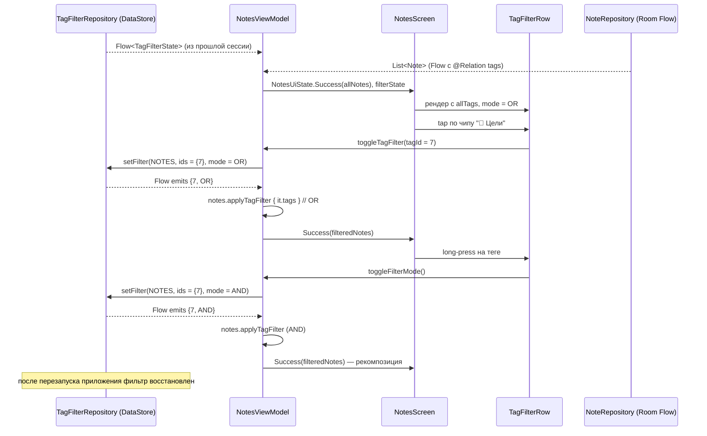
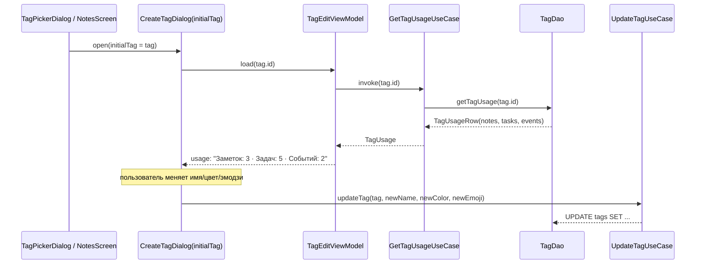
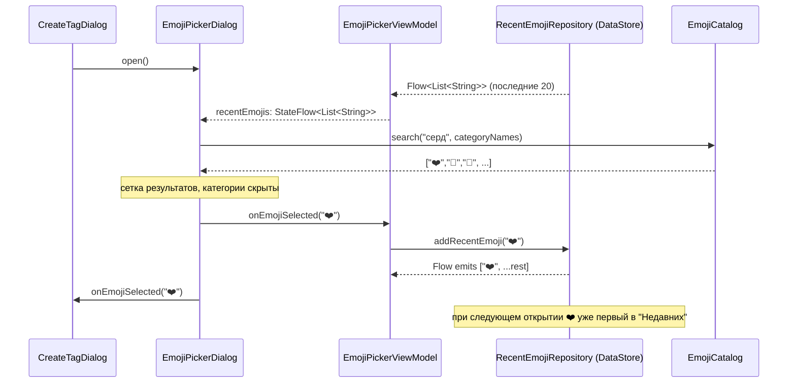
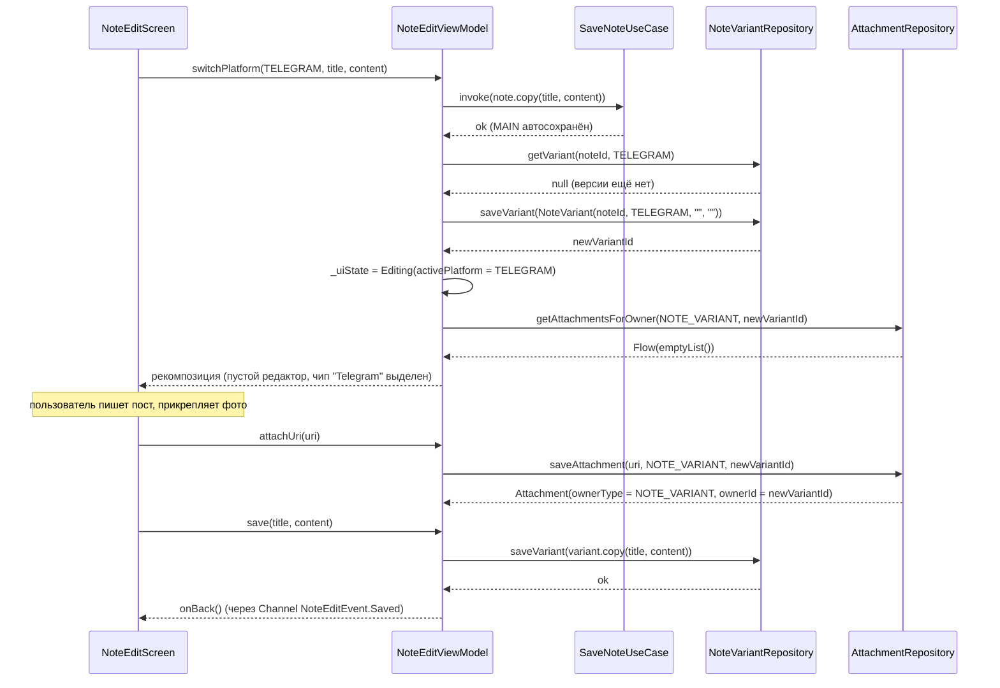

# 🏗 Архитектура PageBook Android

## 🎯 Обзор

PageBook Android следует официальным рекомендациям Google по архитектуре
приложений и использует **Clean Architecture** с тремя слоями:

- **UI Layer** — Compose + ViewModel + UI State.
- **Domain Layer** — Use Cases, доменные модели, интерфейсы репозиториев.
- **Data Layer** — Room, DAO, реализации репозиториев, мапперы, DataStore, файловое хранилище.

Внедрение зависимостей — **Hilt** (`@HiltAndroidApp`, `@HiltViewModel`,
`@Binds`-модули в `data/di/`).

Навигация — **type-safe** на основе `@Serializable` destinations
(Navigation Compose 2.8+), с поддержкой **адаптивных лейаутов**
(`NavigationSuiteScaffold` для BottomBar/Rail, `ListDetailPaneScaffold`
для планшетов).

> **Статус миграции:** Clean Architecture полностью внедрена для всех трёх
> модулей — **Notes**, **Tasks** и **Events (Calendar)**. Все три БД объединены
> в одну `PageBookDatabase` (version **5**). Сквозная система **тегов с кастомизацией
> цвета и эмодзи** доведена до полноценного UX: **фильтрация списков** (OR/AND,
> persist через DataStore, badge с count), **редактирование тегов** и **счётчик
> использования**. Эмодзи-пикер получил **поиск** (по ключевым словам,
> Unicode-имени и категории) и **секцию недавних** (последние 20 в `DataStore`).
> Добавлена **подсистема вложений** (изображения + файлы, app-private storage,
> MediaStore, **системная камера** через `FileProvider`), **fullscreen-просмотр
> вложений** с pinch-to-zoom (`FullScreenAttachmentViewer`), **глобальная система
> уведомлений** (кастомный `Snackbar` с аватаром-фурсоной) и **пасхалка** в
> настройках. **Мультиверсионные заметки для соцсетей** позволяют вести одну
> заметку с несколькими адаптациями под разные платформы (Telegram, VK,
> Instagram, X, Mastodon) — каждая версия хранится в `NoteVariant` и имеет
> собственные вложения. UI переведён на Material 3 Expressive, локализован на
> `ru`/`en`, добавлена адаптивность под планшеты.

## 🛠 Технологический стек

| Компонент           | Технология                                                                          | Версия         |
|:--------------------|:------------------------------------------------------------------------------------|:---------------|
| Язык                | Kotlin                                                                              | 2.2.20         |
| UI                  | Jetpack Compose + **Material 3 Expressive**                                         | BOM 2026.09.00 |
| Архитектура         | Clean Architecture (UI/Domain/Data)                                                 | —              |
| Локальное хранилище | Room (одна БД `pagebook.db`)                                                        | 2.7.2          |
| Rich text           | RichEditor (Compose Multiplatform)                                                  | —              |
| Файловое хранилище  | App-private (`filesDir/attachments/`) + `cacheDir` (камера) + MediaStore (download) | —              |
| Камера              | `ActivityResultContracts.TakePicture()` + `FileProvider`                            | —              |
| Настройки           | DataStore Preferences (**тема + фильтры тегов + недавние эмодзи**)                  | 1.2.1          |
| Язык приложения     | `AppCompatDelegate.setApplicationLocales()`                                         | appcompat 1.7  |
| Асинхронность       | Coroutines & Flow + `Channel` для one-shot событий                                  | 1.10.2         |
| DI                  | **Hilt** (`@Binds` + `@Provides`)                                                   | 2.56.2         |
| Навигация           | Navigation Compose (type-safe) + `material3-adaptive-*`                             | 2.9.0          |
| ML                  | **ML Kit Entity Extraction** (beta)                                                 | 16.0.0-beta6   |
| Сборка              | AGP                                                                                 | 9.4.1          |
| SDK                 | compileSdk 37 / targetSdk 36 / minSdk 28                                            | —              |
| JDK                 | Java 21                                                                             | —              |

## 📂 Структура пакетов

```text
ru.maxgog.pagebook
├── PageBookApplication.kt        # @HiltAndroidApp
├── MainActivity.kt               # AppCompatActivity + enableEdgeToEdge() + setContent
├── Converters.kt                 # LocalDate ↔ String + toKotlinxLocalDate()
│
├── core/
│   └── notification/             # AppNotification, AppNotificationManager,
│                                 #   AppNotificationType (SUCCESS/ERROR/INFO/EASTER_EGG)
│
├── data/
│   ├── dao/                      # NoteDao, TaskDao, EventDao, TagDao (+ TagUsageRow),
│   │                             #   NoteVariantDao
│   ├── local/                    # AttachmentDao, AttachmentEntity
│   ├── models/                   # Entity-классы + @Relation-обёртки
│   │                             #   (NoteModel, NoteVariantModel, ...)
│   ├── rooms/                    # PageBookDatabase, Migrations (2→3, 3→4, 4→5)
│   ├── file/                     # AttachmentFileStore, MediaStoreDownloader
│   ├── mapper/                   # NoteMapper, TaskMapper, EventMapper, TagMapper,
│   │                             #   AttachmentMapper, NoteVariantMapper
│   ├── repository/               # *RepositoryImpl, SettingsRepository,
│   │                             #   TagFilterRepositoryImpl (DataStore),
│   │                             #   RecentEmojiRepositoryImpl (DataStore),
│   │                             #   NoteVariantRepositoryImpl
│   └── di/                       # DatabaseModule, RepositoryModule,
│                                 #   DataStoreModule, AttachmentsModule
│
├── domain/
│   ├── model/                    # Note, Task, Event, Tag, TagColor,
│   │                             #   Attachment, AttachmentType, OwnerType,
│   │                             #   NoteVariant, NotePlatform,
│   │                             #   TagFilterState, FilterMode, TagFilterModule,
│   │                             #   TagUsage
│   ├── repository/               # NoteRepository, TaskRepository, EventRepository,
│   │                             #   TagRepository, TagFilterRepository,
│   │                             #   RecentEmojiRepository, AttachmentRepository,
│   │                             #   NoteVariantRepository
│   ├── usecase/                  # note/, task/, event/, tag/, attachment/
│   │                             #   (note/ включает GetVariantsForNoteUseCase,
│   │                             #    SaveNoteVariantUseCase, DeleteNoteVariantUseCase)
│   └── util/                     # TagFilterExt.kt (applyTagFilter)
│
└── ui/
    ├── app/                      # CombinedApp — NavigationSuiteScaffold,
    │                             #   MainViewModel (провайдер AppNotificationManager)
    ├── navigation/               # Destinations.kt, AppNavHost.kt, BottomNavBar.kt
    ├── notification/             # AppNotificationHost, FursonaSnackbar,
    │                             #   FursonaSnackbarVisuals
    ├── components/               # TagChip (+onEdit/onLongClick), CompactTagChip,
    │                             #   CreateTagDialog (create/edit), TagPickerDialog
    │                             #   (+onEditTag), TagFilterRow (+mode toggle),
    │                             #   FilterBadgeIcon, TagEditViewModel,
    │                             #   EmojiCatalog (+keywords + search()), EmojiPickerDialog,
    │                             #   EmojiPickerViewModel (недавние эмодзи),
    │                             #   OverflowMenu, AttachmentPreviewList,
    │                             #   AttachmentImageLoader, AttachmentPicker,
    │                             #   CameraPicker (TakePicture + FileProvider),
    │                             #   FullScreenAttachmentViewer (pinch/double-tap zoom),
    │                             #   ResizeImageDialog
    ├── notes/                    # NotesScreen, NoteEditScreen (+PlatformSelectorRow,
    │                             #   NotePlatform.labelRes) + ViewModels + UiStates + NoteItem
    ├── tasks/                    # TaskListScreen, TaskEditScreen, TaskItem,
    │                             #   TaskListDetailPane + ViewModels + UiStates
    ├── calendar/                 # CalendarScreen, AddEventDialog, DateTimePickerDialog,
    │                             #   EventItem, CalendarViewModel
    ├── settings/                 # SettingsScreen, SettingsViewModel, AppLanguage,
    │                             #   ThemePreference, LanguagePreference,
    │                             #   SettingsGroup, FursonaEasterEgg
    └── theme/                    # Color, Type, Theme, AppTheme (enum ThemeMode)
```

## 💾 Единая база данных `PageBookDatabase`

Проект использует **одну `RoomDatabase`** с **девятью сущностями** — это
необходимое условие для сквозной системы тегов через `ForeignKey`,
хранения вложений с общим `ownerType`/`ownerId` и мультиверсионных заметок.

```kotlin
@Database(
    entities = [
        NoteModel::class, TaskModel::class, EventModel::class, TagModel::class,
        NoteTagCrossRef::class, TaskTagCrossRef::class, EventTagCrossRef::class,
        AttachmentEntity::class, NoteVariantModel::class
    ],
    version = 5,
    exportSchema = true
)
abstract class PageBookDatabase : RoomDatabase() {
    abstract fun noteDao(): NoteDao
    abstract fun taskDao(): TaskDao
    abstract fun eventDao(): EventDao
    abstract fun tagDao(): TagDao
    abstract fun attachmentDao(): AttachmentDao
    abstract fun noteVariantDao(): NoteVariantDao
}
```

### Связи между сущностями

| Связь                        | Реализация                                                                                        |
|:-----------------------------|:--------------------------------------------------------------------------------------------------|
| **Note → Task**              | `TaskModel.noteId` + `Index("NoteId")`. `onDelete = SET_NULL`.                                    |
| **Note ↔ Tag**               | Junction `NoteTagCrossRef` с `onDelete = CASCADE`                                                 |
| **Task ↔ Tag**               | Junction `TaskTagCrossRef` с `onDelete = CASCADE`                                                 |
| **Event ↔ Tag**              | Junction `EventTagCrossRef` с `onDelete = CASCADE`                                                |
| **Attachment → Note / Task / NoteVariant** | Полиморфная связь через `ownerType: OwnerType` + `ownerId: Int` + `Index("ownerType", "ownerId")` (`OwnerType.NOTE_VARIANT` — для вложений версий) |
| **Note → NoteVariant**       | `NoteVariantModel.noteId` с `ForeignKey(NoteModel, onDelete = CASCADE)` + `Index("noteId")` + **уникальный** `Index("noteId", "platform")` — у заметки не может быть двух версий одной платформы |

## 📝 Мультиверсионные заметки для соцсетей

Пользователь (например, художник или контент-мейкер) пишет пост один раз
и заводит **несколько версий** одной и той же заметки, адаптированных
под разные соцсети. Оригинал хранится в самой `Note`, каждая версия — в
`NoteVariant`.

### 🧩 Domain-модели

```kotlin
// domain/model/NotePlatform.kt
enum class NotePlatform { MAIN, TELEGRAM, VK, INSTAGRAM, TWITTER, MASTODON }

// domain/model/NoteVariant.kt
data class NoteVariant(
    val id: Int = 0,
    val noteId: Int,
    val platform: NotePlatform,
    val title: String = "",
    val content: String = "",       // HTML, как и Note.content
    val createdAt: Long = System.currentTimeMillis()
)
```

- **`NotePlatform.MAIN`** — «оригинал». Хранится **не** в `NoteVariant`, а в
  самой `Note`. Это позволяет не плодить запись для базовой версии и
  упрощает списки/поиск.
- **`NoteVariant`** — data-класс с `id` (autoincrement PK), `noteId` (FK
  на `notes.NoteId` с `CASCADE`), `platform` (String в БД, enum в Domain),
  `title`/`content` (HTML) и `createdAt`. Уникальность пары `(noteId, platform)`
  гарантируется **unique index** на уровне БД.

### 🗄 Data Layer

- **`NoteVariantModel`** — entity в `data/models/` с `ForeignKey(NoteModel)`
    + `Index("noteId")` + `Index(["noteId", "platform"], unique = true)`.
- **`NoteVariantDao`** — `getForNote(noteId): Flow<List<NoteVariantModel>>`,
  `getByPlatform(noteId, platform)`, `insert` (`REPLACE`), `update`, `delete`.
- **`NoteVariantRepository`** (Domain) + **`NoteVariantRepositoryImpl`** (Data, `@Singleton`).
- **`NoteVariantMapper`** — `NoteVariant ↔ NoteVariantModel` (`platform.name`
  в обе стороны).
- **`MIGRATION_4_5`** — создаёт таблицу `note_variants` с индексами.
  В `DatabaseModule` **подключена** через `.addMigrations(2_3, 3_4, 4_5)`;
  `fallbackToDestructiveMigration()` **убран** — данные пользователей
  сохраняются.
- **Hilt:** `@Binds NoteVariantRepository ← NoteVariantRepositoryImpl` в
  `RepositoryModule`; `@Provides NoteVariantDao` в `DatabaseModule`.

### 🧠 Use Cases

В `domain/usecase/note/`:

| Use Case                        | Назначение                                            |
|:--------------------------------|:------------------------------------------------------|
| `GetVariantsForNoteUseCase`     | `Flow<List<NoteVariant>>` для редактора и списка      |
| `SaveNoteVariantUseCase`        | insert (id = 0) или update; возвращает `id`           |
| `DeleteNoteVariantUseCase`      | удаление (каскадно снесёт и вложения в БД)            |

### 🎨 UI: переключение версий в `NoteEditScreen`

```
TopAppBar (title: "Edit note · Telegram")
└── PlatformSelectorRow (FlowRow под TopAppBar)
    ├── FilterChip "Original"        — MAIN
    ├── FilterChip "Telegram" (✕)    — variant
    ├── FilterChip "VK"        (✕)    — variant
    └── AssistChip "Add version" → DropdownMenu(unused platforms)
```

**Поведение:**

1. При открытии сохранённой заметки `activePlatform = MAIN`; редактор
   показывает `note.title` / `note.content`.
2. Тап по чипу версии → `viewModel.switchPlatform(platform, currentTitle, currentContent)`:
    - **текущая платформа автосохраняется** (чтобы не терять ввод);
    - если версии ещё нет — создаётся пустая `NoteVariant(noteId, platform)`;
    - `_uiState = Editing(activePlatform = platform, ...)`.
3. Пока `activePlatform != MAIN` — `titleState`/`richTextState` сбрасываются
   из выбранного варианта через `LaunchedEffect(activePlatform, note.id)`.
4. Кнопка ✓ сохраняет **только активную платформу** и возвращает назад
   (через One-Shot `NoteEditEvent.Saved`).
5. Тап по ✕ на чипе варианта → `deleteVariant(platform)`:
    - вложения варианта удаляются вручную (`OwnerType.NOTE_VARIANT`);
    - запись `NoteVariant` удаляется (FK CASCADE подчищает остатки);
    - если активная платформа была удалена — переключаемся на `MAIN`.
6. Для **новой заметки** селектор платформ скрыт с подсказкой
   «Сохраните заметку, чтобы добавить версии» — версии требуют `noteId`.

### 📎 Вложения версий

Инфраструктура вложений **не меняется** — просто добавляется `OwnerType.NOTE_VARIANT`:

```kotlin
enum class OwnerType { NOTE, TASK, EVENT, NOTE_VARIANT }
```

- `AttachmentFileStore`, `SaveAttachmentUseCase`, `MediaStoreDownloader`,
  `AttachmentPreviewList` работают как есть.
- В `NoteEditViewModel.attachUri()` владелец выбирается по `activePlatform`:
  `NOTE + note.id` для `MAIN`, `NOTE_VARIANT + variant.id` для версии.
- **Вложения реактивно переключаются** через `flatMapLatest` по
  `activePlatform to variants`:
  ```kotlin
  _uiState
      .map { it as? Editing }
      .filterNotNull()
      .distinctUntilChangedBy { it.activePlatform to it.variants.map { v -> v.id to v.platform } }
      .flatMapLatest { state ->
          when (state.activePlatform) {
              MAIN -> getAttachmentsForNote(note.id)
              else -> state.variants.find { it.platform == state.activePlatform }
                  ?.let { attachmentRepository.getAttachmentsForOwner(NOTE_VARIANT, it.id) }
                  ?: flowOf(emptyList())
          }
      }
  ```
- При **удалении заметки** каскадом удаляются её `NoteVariant`, но т.к.
  у `AttachmentEntity` нет FK — вложения удаляются вручную:
  для `MAIN` — `getAttachmentsForNote`, для каждой версии — `getAttachmentsForOwner`.

### 🧭 Ключевые решения по фиче

| Решение                                                        | Обоснование |
|:---------------------------------------------------------------|:------------|
| **`NoteVariant` — отдельная таблица, а не JSON-поле в `Note`** | Индексы, FK, отдельный `ownerId` для вложений без правок `AttachmentDao`. |
| **`NotePlatform.MAIN` без записи в `note_variants`**           | Не дублируем оригинал; `Note` остаётся единым источником для списков. |
| **Unique index `(noteId, platform)`**                          | Гарантия «одна версия на платформу» на уровне БД, а не в коде. |
| **Автосохранение при `switchPlatform`**                        | Пользователь не теряет ввод при переключении вкладок-платформ. |
| **`OwnerType.NOTE_VARIANT`**                                   | Переиспользуем всю подсистему вложений (FileStore, MediaStore, PreviewList, viewer) без изменений. |
| **`flatMapLatest` по `activePlatform`**                        | Единый реактивный поток вложений; UI не знает о двух источниках. |
| **Подсказка для новой заметки**                                | Версии требуют `noteId` → сначала `SaveNoteUseCase`, потом варианты. |
| **`MIGRATION_4_5` вместо `fallbackToDestructiveMigration`**    | Пользовательские данные переживают обновление БД. |

### 🔄 Sequence: переключение версий



## 🏷️ Система тегов

Теги — **сквозная фича**, кастомизируются цветом (7 вариантов) и
опциональным эмодзи (200+ в 10 категориях). Работают на заметках, задачах
и событиях одновременно через many-to-many (`@Junction`).

### Особенности
- **`emoji: String?`** — опционально. Без эмодзи рисуется цветная точка, с эмодзи — символ в `leadingIcon`.
- **`_pendingTags` / `selectedTags`** — ViewModel накапливает выбранные теги для новых (ещё не сохранённых) сущностей, привязка происходит после `save*`.
- **`EmojiCatalog`** — статический объект (`@StringRes` для категорий), не требует сети. Хранит **словарь ключевых слов** (`ru` + `en`) и умеет искать эмодзи через `search(query, categoryNames)`.
- **`TagUsage`** — счётчик использования тега (`notes` / `tasks` / `events`), вычисляется через 3 `SELECT COUNT(*)` по junction-таблицам в `TagDao.getTagUsage(tagId)`.

### 🔍 Фильтрация списков по тегам

Единый паттерн во всех трёх модулях (**Notes**, **Tasks**, **Calendar**):

1. **`TagFilterRow`** (`ui/components/`) — горизонтальный `LazyRow`:
    - слева — `AssistChip` режима **`OR`/`AND`** (переключается тапом);
    - далее — `FilterChip` по каждому тегу (`TagChip` с `selected` для выбранных);
    - **long-press на любом теге** тоже переключает режим (`onLongClick` в `TagChip`);
    - в конце — `AssistChip` «Сбросить», если есть выбранные теги.
    - Компонент не рендерится, если `allTags` пуст.
2. **`FilterBadgeIcon`** (`ui/components/`) — `IconButton` с `BadgedBox` в
   `TopAppBar`: показывает `filterState.count` (количество выбранных тегов)
   и по тапу скрывает/показывает `TagFilterRow`. Это избавляет от лишнего
   вертикального пространства, когда фильтр не активен.
3. **`TagFilterState`** (`domain/model/`):
   ```kotlin
   data class TagFilterState(
       val tagIds: Set<Int> = emptySet(),
       val mode: FilterMode = FilterMode.OR  // OR | AND
   )
   ```
4. **`TagFilterRepository`** (DataStore) — persist-фильтра по модулю:
    - `getFilter(module): Flow<TagFilterState>`;
    - `setFilter(module, state)` — пишет `tag_filter_<module>_ids` и `tag_filter_<module>_mode`;
    - `clearFilter(module)` — сбрасывает оба ключа.
    - `module: TagFilterModule` (`NOTES` / `TASKS` / `CALENDAR`) — каждый экран
      помнит свой фильтр независимо.
5. **`applyTagFilter`** (`domain/util/TagFilterExt.kt`) — общая утилита,
   устраняющая дублирование OR/AND между тремя ViewModel:
   ```kotlin
   fun <T> List<T>.applyTagFilter(
       filter: TagFilterState,
       tagsOf: (T) -> List<Tag>
   ): List<T> { /* OR / AND */ }
   ```
6. **OR-логика** — сущность проходит, если у неё есть **хотя бы один** из
   выбранных тегов. **AND-логика** — должны присутствовать **все** выбранные
   теги. Пустой `Set` — фильтр выключен (поведение идентично OR и AND).
7. **Календарь дополнительно**: `CalendarUiState.datesWithEvents: Set<LocalDate>`
   вычисляется из **отфильтрованного** списка → точки-индикаторы на днях
   автоматически сужаются под фильтр. Заодно это исправило баг — раньше
   точка рисовалась только на выбранном дне, а не на всех днях с событиями.
8. **Пустой результат** при активном фильтре → `EmptyState` с
   `R.string.no_matching_items` («Ничего не найдено») вместо
   «Нет заметок / задач / событий».

```kotlin
// Паттерн (NotesViewModel / TaskListViewModel / CalendarViewModel)
val filterState: StateFlow<TagFilterState> = tagFilterRepository
    .getFilter(TagFilterModule.NOTES)
    .stateIn(viewModelScope, SharingStarted.WhileSubscribed(5_000), TagFilterState())

val uiState: StateFlow<NotesUiState> = combine<List<Note>, TagFilterState, NotesUiState>(
    getAllNotesUseCase(),
    filterState
) { notes, filter ->
    NotesUiState.Success(notes.applyTagFilter(filter) { it.tags })
}
    .catch { emit(NotesUiState.Error(it.message ?: "Unknown error")) }
    .stateIn(viewModelScope, SharingStarted.WhileSubscribed(5_000), NotesUiState.Loading)

fun toggleTagFilter(tagId: Int) = viewModelScope.launch {
    val cur = filterState.value
    val newIds = if (tagId in cur.tagIds) cur.tagIds - tagId else cur.tagIds + tagId
    tagFilterRepository.setFilter(TagFilterModule.NOTES, cur.copy(tagIds = newIds))
}

fun toggleFilterMode() = viewModelScope.launch {
    val cur = filterState.value
    val newMode = if (cur.mode == FilterMode.OR) FilterMode.AND else FilterMode.OR
    tagFilterRepository.setFilter(TagFilterModule.NOTES, cur.copy(mode = newMode))
}

fun clearTagFilter() = viewModelScope.launch {
    tagFilterRepository.clearFilter(TagFilterModule.NOTES)
}
```

> **Почему фильтрация в ViewModel, а не SQL-запросом:** список уже
> загружается реактивно из Room вместе с `@Relation tags` — фильтрация
> в памяти бесплатна и не требует новых DAO-запросов. При росте объёма
> данных до десятков тысяч записей имеет смысл перейти на
> `SELECT ... WHERE id IN (SELECT noteId FROM note_tag_cross_ref WHERE tagId IN (...))`
> с `Flow`-подпиской на параметр.

### ✏️ Редактирование тегов и счётчик использования

`CreateTagDialog` работает в двух режимах:

| Режим          | `initialTag` | Заголовок  | Кнопка подтверждения | Usage                                                     |
|:---------------|:-------------|:-----------|:---------------------|:----------------------------------------------------------|
| Создание       | `null`       | `new_tag`  | `create`             | —                                                         |
| Редактирование | `Tag`        | `edit_tag` | `save`               | `tag_usage_format` («Заметок: N · Задач: N · Событий: N») |

- **`TagEditViewModel`** (`ui/components/`) — `@HiltViewModel`, отдельный от
  родительского экрана. При `initialTag != null` подгружает `TagUsage`
  через `GetTagUsageUseCase` и отдаёт в диалог через `usage: StateFlow<TagUsage?>`.
- **`TagChip.onEdit`** — иконка карандаша в `trailingIcon`; отображается
  только если передан колбэк. Это позволяет переиспользовать `TagChip`
  в `TagPickerDialog` (редактирование из редакторов заметок/задач)
  без обязательного показа кнопки.
- **`TagPickerDialog.onEditTag`** — опциональный колбэк, который
  открывает `CreateTagDialog(initialTag = tag, …)` поверх пикера.
  По умолчанию `null` (в `AddEventDialog` сейчас не передаётся).
- **`UpdateTagUseCase`** — валидирует имя (`require(trimmed.isNotEmpty())`),
  копирует `Tag` с новыми `name`/`colorHex`/`emoji`.

### 🔎 Emoji picker: поиск и недавние

`EmojiPickerDialog` (`ui/components/`) — общий компонент выбора эмодзи,
используется в `CreateTagDialog` и доступен для любого другого сценария.
Помимо сетки по категориям, поддерживает **поиск** и **секцию недавних**.

#### Поиск: 4 канала матчинга

`EmojiCatalog.search(query, categoryNames)` — чистая функция без Compose,
поэтому легко тестируется юнит-тестами. Совпадения ищутся одновременно по:

1. **Самому символу** — пользователь может вставить `🎯` из буфера.
2. **Ключевым словам** `ru/en` из `Map<String, List<String>> keywords` —
   `"серд"` → все сердца, `"работа"` → 💼, `"cat"` → 🐱 (если появится в каталоге).
3. **Unicode-имени** через `Character.getName(codePoint)` — fallback,
   покрывает даже эмодзи без явных ключевых слов (`"grinning"`, `"face"`).
4. **Названию категории** — `categoryNames` передаются с UI через
   `stringResource(cat.nameRes)` (уже локализованы), поэтому запрос
   `"работа"` тянет всю категорию Work.

```kotlin
fun search(query: String, categoryNames: List<String>): List<String> {
    val q = query.trim().lowercase()
    if (q.isEmpty()) return emptyList()
    val raw = query.trim()

    return categories.flatMapIndexed { idx, cat ->
        val catName = categoryNames.getOrNull(idx)?.lowercase().orEmpty()
        val byCategory = catName.isNotEmpty() && catName.contains(q)
        cat.emojis.filter { emoji ->
            byCategory ||
                emoji == raw ||
                keywords[emoji]?.any { it.lowercase().contains(q) } == true ||
                unicodeName(emoji)?.lowercase()?.contains(q) == true
        }
    }.distinct()
}
```

> **Почему категория-имена передаются с UI, а не берутся из ресурсов
> внутри `object`:** `EmojiCatalog` — обычный Kotlin-объект, у него нет
> `Context`, а `stringResource` — `@Composable`. Передача готового списка
> из UI сохраняет `object` чистым и тестируемым, а локализация остаётся
> в UI-слое.

#### Недавние: `RecentEmojiRepository` (DataStore)

- **`RecentEmojiRepository`** (Domain, interface) — `getRecentEmojis(): Flow<List<String>>` + `addRecentEmoji(emoji)`.
- **`RecentEmojiRepositoryImpl`** (Data, `@Singleton`) — DataStore Preferences, ключ `recent_emojis`.
    - Хранит **до 20** эмодзи.
    - **Дедуплицирует**: выбранный эмодзи перемещается в начало.
    - Сериализация — `joinToString("|")`. `|` безопасен: эмодзи никогда не содержат его.
- **`EmojiPickerViewModel`** (`ui/components/`, `@HiltViewModel`):
  ```kotlin
  val recentEmojis: StateFlow<List<String>> = recentEmojiRepository
      .getRecentEmojis()
      .stateIn(viewModelScope, SharingStarted.WhileSubscribed(5_000), emptyList())
  ```
- При выборе эмодзи в диалоге (`select(emoji)`): сначала
  `viewModel.onEmojiSelected(emoji)` → запись в DataStore, затем
  `onEmojiSelected(emoji)` → возврат в `CreateTagDialog`. К моменту
  следующего открытия пикера недавние уже обновлены (DataStore → Flow → `StateFlow`).

#### UI-поток в `EmojiPickerDialog`

```
AlertDialog
├── OutlinedTextField (поиск, Icons.Search, кнопка Clear)
└── if (isSearching)
    ├── LazyVerticalGrid(searchResults)   // категории и недавние скрыты
    └── "Эмодзи не найдены" при пустом результате
    else
    ├── "Недавние" + LazyRow(recentEmojis)  // только если не пусто
    ├── LazyRow(categories → FilterChip)
    └── LazyVerticalGrid(selectedCategory.emojis)
```

- Секция недавних **не рендерится**, если список пуст — не засоряет UI.
- Пустой результат поиска → `R.string.no_emojis_found`.
- Кнопка «Без эмодзи» (`onEmojiSelected(null)`) работает из любого режима.

## 📎 Подсистема вложений (Attachments)

Вложения поддерживаются в заметках, задачах **и версиях заметок** через
**полиморфную связь** (`ownerType: OwnerType` + `ownerId: Int`). Это позволяет
не плодить отдельные таблицы и один и тот же UI-компонент
(`AttachmentPreviewList`) переиспользовать во всех редакторах.

Источники вложения:
- **Photo Picker** (`ActivityResultContracts.PickVisualMedia`) — `rememberPhotoPicker`;
- **Системная камера** (`ActivityResultContracts.TakePicture()`) — `rememberCameraPicker`;
- **Документы** (`ActivityResultContracts.OpenDocument`) — `rememberFilePicker`.

### ⚠️ Ключевая особенность: `localPath` — относительный

`AttachmentFileStore.save()` кладёт файл в `filesDir/attachments/<uuid>.<ext>`
и возвращает **относительный** путь (`"<uuid>.<ext>"`), а не абсолютный.
Поэтому **все** места, где нужно прочитать файл, обязаны разрешать путь
относительно корня:

```kotlin
// ✅ Правильно
val file = File(File(context.filesDir, "attachments"), attachment.localPath)

// ❌ Неправильно — ищет файл в корне рабочей директории процесса
val file = File(attachment.localPath)
```

Это правило касается `AttachmentPreviewList.kt`, `AttachmentImageLoader.kt`,
`FullScreenAttachmentViewer.kt` и `AttachmentFileStore.open()`.

### 📷 Камера как источник изображения

**`rememberCameraPicker`** (`ui/components/CameraPicker.kt`) — обёртка над
`ActivityResultContracts.TakePicture()`:

- Временный снимок пишется в `cacheDir/camera_<timestamp>.jpg`.
- Отдаётся системной камере через **`FileProvider`**
  (`authority = "${packageName}.fileprovider"`). Провайдер объявлен
  в `AndroidManifest.xml`, пути — в `res/xml/file_paths.xml`
  (`<cache-path name="camera_cache" path="." />`).
- При `success = true` колбэк получает `content-URI` → прокидывает в
  `attachUri()` → `SaveAttachmentUseCase` копирует содержимое в
  `filesDir/attachments/<uuid>.jpg`. Кэш-файл в `cacheDir` остаётся
  и вычищается системой.
- При `success = false` пустой кэш-файл удаляется, `pendingFile`
  сбрасывается.
- **Разрешение `CAMERA` не требуется:** `ACTION_IMAGE_CAPTURE`
  выполняет отдельное приложение камеры, которое само управляет
  своими правами.

> **Почему `FileProvider`, а не `MediaStore.Images.Media.insert`:** на
> API 29+ вставка в `MediaStore` требует либо `WRITE_EXTERNAL_STORAGE`
> (deprecated), либо сценарного `MediaStore` API, который тянет за собой
> лишние разрешения и `ContentValues`. `FileProvider` + `cacheDir`
> не требует разрешений и работает одинаково на всех API 28+, а файл
> временно полностью под контролем приложения.

### 🖼 Fullscreen-просмотр вложений

**`FullScreenAttachmentViewer`** (`ui/components/FullScreenAttachmentViewer.kt`) —
`Dialog(usePlatformDefaultWidth = false, decorFitsSystemWindows = false)`
на весь экран.

- **Жесты:**
    - **pinch-to-zoom** через `rememberTransformableState` — масштаб 1×..5×;
      панорамирование двумя пальцами срабатывает только при `scale > 1`,
      при возврате к 1× `offset` сбрасывается в `Offset.Zero`;
    - **double-tap** через `detectTapGestures(onDoubleTap = …)` — переключает
      1× ↔ 2.5×;
    - **back / кнопка «Закрыть»** — `onDismiss`.
- **Верхняя панель** (`Surface` с `Color.Black.copy(alpha = 0.45f)` +
  `windowInsetsPadding(WindowInsets.statusBars)`): закрыть, имя файла,
  скачать (тот же `downloadAttachment` из ViewModel).
- **Bitmap кэшируется** через `remember(attachment.localPath)` — при
  повторном открытии того же вложения повторного `decodeFile` не происходит.
- **Вызов:** `AttachmentPreviewList` принимает опциональный
  `onImageClick: ((Attachment) -> Unit)? = null`; тап по превью
  изображения открывает viewer. Внутренние `IconButton` (крестик/
  скачивание) перехватывают свои клики, поэтому тап по иконке
  удаляет/скачивает, а по самой картинке — открывает fullscreen.

```kotlin
// В NoteEditScreen / TaskEditScreen
var viewingAttachment by remember { mutableStateOf<Attachment?>(null) }

AttachmentPreviewList(
    attachments = currentAttachments,
    onRemove = viewModel::removeAttachment,
    onDownload = viewModel::downloadAttachment,
    onImageClick = { viewingAttachment = it }
)

viewingAttachment?.let { attachment ->
    FullScreenAttachmentViewer(
        attachment = attachment,
        onDismiss = { viewingAttachment = null },
        onDownload = { viewModel.downloadAttachment(attachment) }
    )
}
```

## 🔔 Глобальная система уведомлений (Snackbar)

В приложении реализована **единая точка показа уведомлений**, избавляющая ViewModel от привязки к `Context` и предотвращающая дублирование `SnackbarHost` на каждом экране.

### Архитектура
1. **`AppNotificationManager`** (`@Singleton`, Hilt) — единый менеджер. Использует `Channel<AppNotification>(BUFFERED)` для гарантированной доставки (по принципу One-Shot событий).
2. **`MainActivity`** — единственное место, где инициализируется `SnackbarHostState` и вызывается `AppNotificationHost`. Он подписывается на `events` менеджера и передаёт их в кастомный `SnackbarHost`.
3. **`FursonaSnackbar`** — кастомный UI. Использует `FursonaSnackbarVisuals` для получения типа уведомления (`SUCCESS`, `ERROR`, `INFO`, `EASTER_EGG`).

### 🦊 Особенности дизайна фурсоны
- Фурсона вынесена за пределы фона `Snackbar` (реализовано через `Box` + `Surface` с отступом).
- Используются цвета Material 3 (`secondaryContainer` для успеха, `errorContainer` для ошибок, `tertiaryContainer` для пасхалок).

### Использование в ViewModel
```kotlin
@HiltViewModel
class NoteEditViewModel @Inject constructor(
    private val notificationManager: AppNotificationManager
) : ViewModel() {
    fun save() {
        // ...
        notificationManager.success(R.string.note_saved)
    }
}
```

## 🎨 Адаптивный UI и навигация

### NavigationSuiteScaffold
`CombinedApp` использует `NavigationSuiteScaffold` для автоматического
переключения между `NavigationBar` (телефоны) и `NavigationRail`
(планшеты/Chromebook). Управление видимостью панели — через `scaffoldState.hide()/show()`.

### ListDetailPaneScaffold (Tasks)
На экранах `Expanded` (`WindowWidthSizeClass.Expanded`) список задач и редактор
открываются в `ListDetailPaneScaffold` (два пена рядом). На телефонах —
обычная навигация `navController.navigate(TaskEditDestination(id))`.

### Google Keep-style Note Editor
`NoteEditScreen`:
- `PlatformSelectorRow` (FlowRow чипов) под `TopAppBar` — только для сохранённых заметок;
- `BasicTextField` без рамки для заголовка;
- Теги в `FlowRow` (переносятся на новую строку);
- Превью вложений (`AttachmentPreviewList`) над редактором — **для активной платформы**;
- `RichTextEditor` на `weight(1f)`;
- `FormattingToolbar` использует `windowInsetsPadding(WindowInsets.navigationBars.union(WindowInsets.ime))` — тулбар **всегда над клавиатурой**;
- Кнопки «Фото», «Камера» и «Файл» в `TopAppBar` — через `rememberPhotoPicker` / `rememberCameraPicker` / `rememberFilePicker`.

## ⚡ One-Shot Events (Channel)

Для навигации после сохранения/удаления вместо `StateFlow<Boolean>`
используется `Channel<T>(Channel.BUFFERED)` + `receiveAsFlow()`.
Это гарантирует доставку события **ровно один раз** и устраняет race condition.

```kotlin
// ViewModel
private val _events = Channel<TaskEditEvent>(Channel.BUFFERED)
val events = _events.receiveAsFlow()

// UI
LaunchedEffect(Unit) {
    viewModel.events.collect { event ->
        when (event) {
            TaskEditEvent.Saved, TaskEditEvent.Deleted -> onBack()
        }
    }
}
```

## ⚙️ Настройки (DataStore + AppCompatDelegate)

Настройки разделены на две зоны ответственности:
1.  **Тема** — хранится в `DataStore<Preferences>` (`SettingsRepository`). Читается через `ThemeViewModel` в `MainActivity` (реактивно).
2.  **Язык** — единый источник правды `AppCompatDelegate.getApplicationLocales()`. Выбор применяется через `AppLanguage.apply()`.

> **DataStore используется и для не-настроечных данных:** `TagFilterRepository`
> (фильтры тегов по модулям) и `RecentEmojiRepository` (недавние эмодзи).
> Это осознанный выбор — оба набора данных маленькие, пользовательские
> и переживают перезапуск; Room для них избыточен.

### UI в стиле Material 3 Expressive
- Группы настроек обёрнуты в `Card` с `RoundedCornerShape(28.dp)`.
- Внутри — `ListItem` с `Color.Transparent`.
- Под каждым пунктом — `supportingContent` с пояснением (`theme_system_desc`, `language_ru_desc` и т.д.).
- В `TopAppBar` всех главных экранов добавлено `OverflowMenu` (три точки) с пунктом «Настройки».

### 🥚 Пасхалка и аватар разработчика
- **Аватар разработчика**: добавлен в `AboutSettings` через `leadingContent` у `ListItem`.
- **Пасхалка**: при 7 быстрых тапах (с паузой не более 1 сек) по номеру версии появляется карточка `FursonaEasterEgg` с анимацией, а также отправляется `EASTER_EGG`-уведомление.

## 🔄 Поток данных (примеры)

### Создание задачи из заметки (ML Kit)


### Прикрепление файла к новой заметке


### Снимок с камеры → вложение


### Fullscreen-просмотр вложения


### Фильтрация списка по тегу (persist + OR/AND)


### Редактирование тега с usage


### Выбор эмодзи с поиском и недавними


### Переключение версии заметки (соцсети)


## 🧭 Ключевые архитектурные решения

| Решение                                                                      | Обоснование                                                                                                                                 |
|:-----------------------------------------------------------------------------|:--------------------------------------------------------------------------------------------------------------------------------------------|
| **Clean Architecture**                                                       | UI не зависит от схемы БД; Use Cases инкапсулируют бизнес-логику.                                                                           |
| **Repository как интерфейс**                                                 | Позволяет подменить источник данных без изменения Domain/UI.                                                                                |
| **UI State (sealed / data class)**                                           | Явные состояния `Loading`/`Success`/`Error` — предсказуемое поведение.                                                                      |
| **One-Shot Events (`Channel`)**                                              | Гарантирует однократный вызов `onBack()` после сохранения.                                                                                  |
| **Глобальный `SnackbarHost` + `Channel`**                                    | Избавляет ViewModel от `Context`, гарантирует доставку, убирает дублирование `SnackbarHost` на каждом экране.                               |
| **Hilt**                                                                     | Масштабируемый DI, генерируемый на этапе компиляции.                                                                                        |
| **Type-safe navigation**                                                     | Компилятор проверяет маршруты и аргументы.                                                                                                  |
| **`AppCompatDelegate` для языка**                                            | Единый источник правды, работающий на всех версиях Android.                                                                                 |
| **Полиморфные вложения (`ownerType` + `ownerId`)**                           | Одна таблица и один UI-компонент для Notes, Tasks и NoteVariant.                                                                            |
| **`localPath` — относительный путь**                                         | Отвязка от абсолютного `filesDir` (меняется между установками/бэкапами).                                                                    |
| **`@Update` для pending-вложений**                                           | Избегаем `SQLiteConstraintException` при повторном `insert` с тем же `id`.                                                                  |
| **`FileProvider` + `cacheDir` для камеры**                                   | Снимок не требует `CAMERA`-разрешения; временный файл полностью под контролем приложения; `SaveAttachmentUseCase` сам копирует в `filesDir` |
| **`TakePicture` + `pendingFile` (File) в state**                             | `TakePicture` не возвращает URI — храним `File`, из него получаем URI в колбэке и умеем `delete()` при отмене.                              |
| **`Dialog(usePlatformDefaultWidth = false)` для fullscreen**                 | Не требует отдельного экрана/навигации; переиспользует `downloadAttachment` из ViewModel.                                                   |
| **`rememberTransformableState` + `graphicsLayer` для zoom**                  | Один state (scale/offset), без ручного `detectTransformGestures`; double-tap через `detectTapGestures`.                                     |
| **`onImageClick` в `AttachmentPreviewList` (опционально)**                   | Внутренние `IconButton` перехватывают свои клики; тап по картинке открывает viewer, тап по иконке — действие.                               |
| **`TagFilterRepository` на DataStore**                                       | Фильтр переживает перезапуск; каждый модуль (`NOTES`/`TASKS`/`CALENDAR`) помнит свой `tagIds + mode`.                                       |
| **`TagFilterState(tagIds, mode)` в Domain**                                  | Тип-безопасное представление фильтра; легко расширять (например, `FilterMode.NOT`), не ломая ViewModel.                                     |
| **`applyTagFilter` — общая утилита в `domain/util`**                         | Устраняет дублирование OR/AND между тремя ViewModel; тестируется один раз.                                                                  |
| **Long-press на `TagChip` + `AssistChip` OR/AND**                            | Два пути переключения режима: быстрый (long-press) и явный (чип) для новичков.                                                              |
| **`FilterBadgeIcon` в `TopAppBar`**                                          | Показывает `count`, а не весь ряд фильтров, — экономит вертикальное место, когда фильтр не активен.                                         |
| **`datesWithEvents` из отфильтрованного списка**                             | Точки-индикаторы в календаре автоматически сужаются под фильтр, без дублирования логики.                                                    |
| **`TagEditViewModel` отдельно от экрана**                                    | Диалог редактирования тега можно открыть из любого места (Notes/Tasks/Calendar) с идентичным UX.                                            |
| **`TagUsage` из 3 `COUNT(*)` в `TagDao`**                                    | Один SQL-запрос вместо трёх последовательных; junction-таблицы уже проиндексированы по `tagId`.                                             |
| **`EmojiCatalog.search(query, categoryNames)` — чистая функция**             | Тестируется без Compose/Context; `object` остаётся свободным от Android-зависимостей.                                                       |
| **Поиск по 4 каналам (символ / keywords ru+en / Unicode-имя / категория)**   | Максимальный охват без ручного описания каждого эмодзи; Unicode-имя — fallback для «забытых» ключевых слов.                                 |
| **`RecentEmojiRepository` на DataStore**                                     | 20 последних эмодзи переживают перезапуск; `@Singleton` + `Flow` дают реактивное обновление UI без ручного refresh.                         |
| **`EmojiPickerViewModel` отдельно от `EmojiPickerDialog`**                   | Диалог остаётся переиспользуемым; логика недавних изолирована и не течёт в `CreateTagDialog`.                                               |
| **Секция «Недавние» рендерится только при непустом списке**                  | Не засоряет UI у нового пользователя; не требует дополнительных условий в родительских экранах.                                             |
| **`NoteVariant` — отдельная таблица, а не JSON-поле в `Note`**               | Индексы, FK-каскад, отдельный `ownerId` для вложений; не раздуваем `NoteModel` и не парсим JSON в hot path.                                 |
| **`NotePlatform.MAIN` без записи в `note_variants`**                         | Оригинал живёт в `Note`; версии — только для дополнительных платформ. Единый источник для списков и поиска.                                 |
| **Unique index `(noteId, platform)`**                                        | «Одна версия на платформу» гарантируется БД, а не кодом.                                                                                    |
| **Автосохранение при `switchPlatform`**                                      | Пользователь не теряет ввод при переключении вкладок-платформ; меньше «забытых» правок.                                                     |
| **`OwnerType.NOTE_VARIANT`**                                                 | Переиспользуем `AttachmentFileStore`, `MediaStoreDownloader`, `AttachmentPreviewList`, `FullScreenAttachmentViewer` без изменений.          |
| **`flatMapLatest` по `activePlatform`**                                      | Единый реактивный поток вложений; UI не знает о двух источниках (Note vs NoteVariant).                                                      |
| **`MIGRATION_4_5` вместо `fallbackToDestructiveMigration`**                  | Данные пользователя переживают обновление БД; миграции накапливаются, а не сбрасывают.                                                      |
| **Подсказка «Сохраните заметку…» для новой заметки**                         | Версии требуют `noteId`; UX заранее объясняет, почему чипы скрыты.                                                                          |
| **Адаптивные лейауты (`NavigationSuiteScaffold`, `ListDetailPaneScaffold`)** | Соответствие гайдлайнам Google для телефонов, планшетов и Chromebook.                                                                       |
| **M3 Expressive (`Card`, `ListItem`)**                                       | Современный вид без alpha-зависимостей.                                                                                                     |
| **`@StringRes` в ViewModel**                                                 | Snackbar-сообщения локализуются без утечек `Context`.                                                                                       |
| **Кастомный `Snackbar` с фурсоной**                                          | Единый стиль уведомлений, брендинг, M3 Expressive (`Surface` + `Box` для выхода за рамки).                                                  |

## 🚀 Планы по развитию

- [x] Внедрить **Hilt** для DI.
- [x] Выделить **Domain Layer** (Use Cases) для всех модулей.
- [x] Подключить **ML Kit** для извлечения дат.
- [x] Объединить три БД в `PageBookDatabase`.
- [x] Добавить **сквозную систему тегов** (7 цветов, many-to-many, эмодзи).
- [x] Добавить **фильтрацию списков по тегам** (Notes / Tasks / Calendar) — `TagFilterRow`, `datesWithEvents` в календаре.
- [x] **Сохранение фильтра** между перезапусками — `TagFilterRepository` на `DataStore`, ключи `tag_filter_<module>_ids/mode`.
- [x] **AND-логика фильтра** — `FilterMode.OR/AND`, long-press на теге + `AssistChip`.
- [x] **Счётчик выбранных тегов** в `TopAppBar` — `FilterBadgeIcon` + `Badge`.
- [x] **Редактирование существующих тегов** — `CreateTagDialog(initialTag = …)`, `TagPickerDialog.onEditTag`, `TagEditViewModel`.
- [x] **Счётчик использования тега** — `TagDao.getTagUsage(tagId)` + `TagUsage` в диалоге редактирования.
- [x] **Поиск по эмодзи в `EmojiPickerDialog`** — `EmojiCatalog.search()` (символ / keywords ru+en / Unicode-имя / категория), пустой результат → `no_emojis_found`.
- [x] **Недавние эмодзи** — `RecentEmojiRepository` (`DataStore`, ключ `recent_emojis`, до 20, дедуп, свежие первыми), `EmojiPickerViewModel`, секция «Недавние» над категориями.
- [x] Реализовать **адаптивный UI** (BottomBar/Rail, два пена на планшетах).
- [x] Перевести UI на **Material 3 Expressive** + локализация (`ru`/`en`).
- [x] Починить смену языка через **`AppCompatDelegate`**.
- [x] Добавить **One-Shot Events** через `Channel`.
- [x] Добавить **подсистему вложений** (изображения + файлы, общая для Notes и Tasks).
- [x] **Камера как источник изображения** — `rememberCameraPicker` (`TakePicture` + `FileProvider`, `cacheDir`), пункт «Сделать фото» в редакторах заметок/задач.
- [x] **Просмотр вложений на весь экран** (fullscreen viewer) — `FullScreenAttachmentViewer` (pinch-to-zoom 1×..5×, double-tap 1×↔2.5×, скачивание из fullscreen), `AttachmentPreviewList.onImageClick`.
- [x] Внедрить **глобальную систему уведомлений** с фурсоной (`AppNotificationManager` + `FursonaSnackbar`).
- [x] Добавить **пасхалку** и аватар разработчика в настройки.
- [x] **Мультиверсионные заметки для соцсетей** — `NoteVariant` (FK на `Note` с `CASCADE`, unique `(noteId, platform)`), `NotePlatform` (MAIN/TELEGRAM/VK/INSTAGRAM/TWITTER/MASTODON), `OwnerType.NOTE_VARIANT` для вложений, `PlatformSelectorRow` в `NoteEditScreen`, автосохранение при переключении, `MIGRATION_4_5`, БД → version 5.
- [ ] `ListDetailPaneScaffold` для Notes и Calendar (аналогично Tasks).
- [ ] **Порядок и иконки платформ в селекторе** — фиксированный порядок популярных соцсетей, иконки брендов в чипах.
- [ ] **Экспорт/«Поделиться» выбранной версии** — `Intent.ACTION_SEND` сразу из редактора активной платформы.
- [ ] **Автоподстановка лимитов** — мягкое предупреждение, если текст версии превышает лимит платформы (например, 4096 для Telegram).
- [ ] Модуляризация (feature-модули).
- [ ] Unit-тесты для Use Cases и Repository (включая `AttachmentRepository`, `applyTagFilter`, `TagFilterRepositoryImpl`, `EmojiCatalog.search`, `RecentEmojiRepositoryImpl`, `NoteVariantRepositoryImpl`, `NoteEditViewModel.switchPlatform`).

## 📚 Полезные ссылки
- [Guide to App Architecture (Google)](https://developer.android.com/topic/architecture)
- [Building adaptive apps with Jetpack Compose](https://developer.android.com/develop/ui/compose/layouts/adaptive)
- [Per-app language preferences](https://developer.android.com/guide/topics/resources/app-languages)
- [Now in Android (официальный референс)](https://github.com/android/nowinandroid)
- [Navigation — type safety](https://developer.android.com/guide/navigation/design/type-safety)
- [ML Kit Entity Extraction](https://developers.google.com/ml-kit/language/entity-extraction)
- [Room — Relationships](https://developer.android.com/training/data-storage/room/relationships)
- [Room — Foreign keys](https://developer.android.com/training/data-storage/room/relationships#foreign-key)
- [Room — Migrations](https://developer.android.com/training/data-storage/room/migrating-db-versions)
- [DataStore — Preferences](https://developer.android.com/topic/libraries/architecture/datastore)
- [Hilt — `@Binds`](https://developer.android.com/training/dependency-injection/hilt-android#hilt-modules)
- [MediaStore — Download files](https://developer.android.com/training/data-storage/shared/media)
- [Photo picker](https://developer.android.com/training/data-storage/shared/photopicker)
- [TakePicture — Activity Result API](https://developer.android.com/training/basics/intents/result#kotlin)
- [FileProvider](https://developer.android.com/reference/androidx/core/content/FileProvider)
- [Compose — FilterChip](https://developer.android.com/develop/ui/compose/components/chip#filter-chip)
- [Compose — Badge](https://developer.android.com/develop/ui/compose/components/badge)
- [Compose — Transformable / pinch-to-zoom](https://developer.android.com/develop/ui/compose/touch-input/pointer-input/multi-touch)
- [Compose — detectTapGestures (double-tap)](https://developer.android.com/develop/ui/compose/touch-input/pointer-input/tap-and-press)
- [Material 3 — Long press / combined gestures](https://developer.android.com/develop/ui/compose/touch-input/pointer-input/drag-swipe-fling)
- [Character.getName — Unicode name](https://docs.oracle.com/javase/8/docs/api/java/lang/Character.html#getName-int-)
- [Unicode emoji list](https://unicode.org/emoji/charts/full-emoji-list.html)