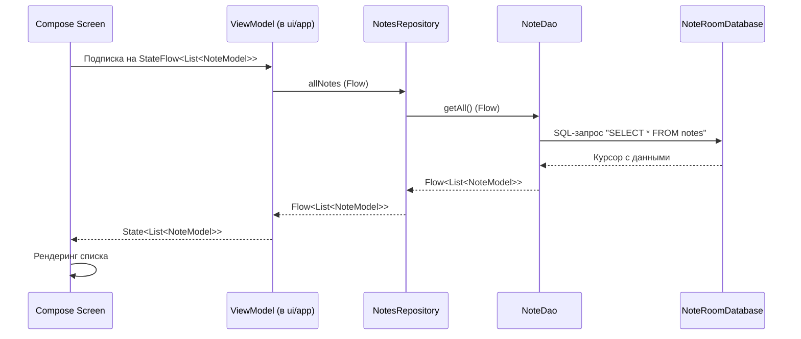

# 🏗 Архитектура PageBook Android

В этом документе описаны архитектурные решения, слои приложения и поток данных. Он предназначен для разработчиков, которые хотят понять кодовую базу или внести вклад в проект.

## 🎯 Обзор

PageBook Android следует официальным рекомендациям Google по архитектуре приложений и использует паттерн **MVVM (Model-View-ViewModel)** с чётким разделением на **UI Layer** и **Data Layer**. На текущем этапе проект намеренно избегает избыточной сложности (например, Domain Layer с Use Cases), чтобы сохранить скорость разработки и читаемость кода.

Приложение состоит из трёх независимых функциональных модулей, каждый из которых имеет собственную базу данных Room:

- **Notes** — заметки
- **Todos** — задачи
- **Events** — события календаря

## 🛠 Технологический стек

| Компонент               | Технология                                        | Назначение                                                    |
|-------------------------|---------------------------------------------------|---------------------------------------------------------------|
| **Язык**                | Kotlin                                            | 100% кода на Kotlin                                           |
| **UI**                  | Jetpack Compose + Material 3                      | Декларативный интерфейс                                       |
| **Архитектура**         | MVVM + Repository                                 | Разделение ответственности                                    |
| **Локальное хранилище** | Room Database                                     | Три независимые БД (`notes_db`, `todo_db`, `event_database`)  |
| **Асинхронность**       | Kotlin Coroutines & Flow                          | Реактивные потоки данных из Room                              |
| **DI**                  | Ручной (Manual DI)                                | Зависимости создаются в `PageBookApplication` через `by lazy` |
| **Навигация**           | Jetpack Compose Navigation (внутри `CombinedApp`) | Переходы между экранами                                       |

> ⚠️ **Важно:** В отличие от многих современных проектов, здесь **не используется Hilt**. Внедрение зависимостей происходит вручную в классе `PageBookApplication`. Это осознанное решение для уменьшения порога входа и упрощения сборки на ранних этапах.

## 📂 Слои и структура пакетов

```
ru.maxgog.pagebook
├── PageBookApplication.kt      # Точка входа, ручное DI (создание репозиториев)
├── MainActivity.kt             # Единственная Activity, хост для Compose
│
├── ui/                         # UI Layer (Compose)
│   ├── app/                    # CombinedApp — корневой Composable с навигацией
│   └── theme/                  # Цвета, типографика, тема Material 3
│
├── models/                     # Модели данных (Entity для Room)
│   ├── NoteModel.kt
│   ├── TodoModel.kt
│   └── EventModel.kt
│
├── dao/                        # Интерфейсы Room DAO
│   ├── NoteDao.kt
│   ├── TodoDao.kt
│   └── EventDao.kt
│
├── rooms/                      # Классы RoomDatabase (Singleton для каждой БД)
│   ├── NoteRoomDatabase.kt
│   ├── TodoRoomDatabase.kt
│   └── EventRoomDatabase.kt
│
└── repositories/               # Repository Layer
├── NotesRepository.kt
├── TodoRepository.kt
└── EventRepository.kt
```

### Краткое описание слоёв

**UI Layer (`ui/`)**
- `CombinedApp()` — корневой Composable, который, предположительно, содержит `NavHost` и связывает экраны.
- Экраны (Screens) и ViewModels **находятся внутри `ui/app` или будут добавлены туда** по мере развития. ViewModels используют репозитории для получения данных.
- Тема оформлена в `ui/theme` в соответствии с Material 3.

**Data Layer (`models/`, `dao/`, `rooms/`, `repositories/`)**
- **Models** — это одновременно и Room-сущности (`@Entity`), и модели данных для UI. На текущем этапе отдельные Domain-модели не выделены.
- **DAO** предоставляют абстракции над SQL-запросами.
- **RoomDatabase** — синглтоны, обеспечивающие единственное подключение к каждой БД. Обратите внимание: в `NoteRoomDatabase` используется `fallbackToDestructiveMigration()`, а в других — нет.
- **Repositories** — тонкая обёртка над DAO. Они скрывают детали источника данных и предоставляют `Flow` или `suspend`-функции для UI-слоя.

## 🔄 Поток данных (Data Flow)

Типичный сценарий: **пользователь открывает список заметок**.



1. ViewModel подписывается на `Flow` из репозитория.
2. Репозиторий делегирует запрос в DAO.
3. Room автоматически отслеживает изменения в таблице и эмитит новые данные.
4. Compose перерисовывает UI при поступлении новых данных.

**Для операций записи** (создание заметки): UI вызывает метод ViewModel → ViewModel вызывает `suspend`-функцию репозитория → репозиторий вызывает `insert` в DAO → Room выполняет INSERT в фоновом потоке (корутины).

## 🧭 Ключевые архитектурные решения

| Решение                       | Обоснование                                                                                                                  |
|-------------------------------|------------------------------------------------------------------------------------------------------------------------------|
| **Три отдельные базы данных** | Функциональные модули (заметки, задачи, события) изолированы. Это упрощает миграции и позволяет развивать модули независимо. |
| **Ручной DI вместо Hilt**     | Уменьшает количество зависимостей и boilerplate на старте. Легко заменить на Hilt при росте проекта.                         |
| **Модели = Entity**           | На текущем этапе отсутствует необходимость в отдельных Domain-моделях, так как UI использует те же поля, что и БД.           |
| **Отсутствие Use Cases**      | Бизнес-логика проста и не требует дополнительного слоя абстракции. ViewModel напрямую работает с репозиториями.              |

## 🚀 Планы по развитию архитектуры

- [ ] Выделить **Domain Layer** (Use Cases) при усложнении бизнес-логики (например, синхронизация, офлайн-режим).
- [ ] Внедрить **Hilt** для масштабируемого DI, если количество зависимостей вырастет.
- [ ] Добавить **отдельные Domain-модели** для отвязки UI от схемы БД.
- [ ] Настроить **модуляризацию** (feature-модули) для ускорения сборки.

## 📚 Полезные ссылки

- [Guide to App Architecture (Google)](https://developer.android.com/topic/architecture)
- [Recommendations for Android architecture](https://developer.android.com/topic/architecture/recommendations)
- [Now in Android (официальный референс)](https://github.com/android/nowinandroid)