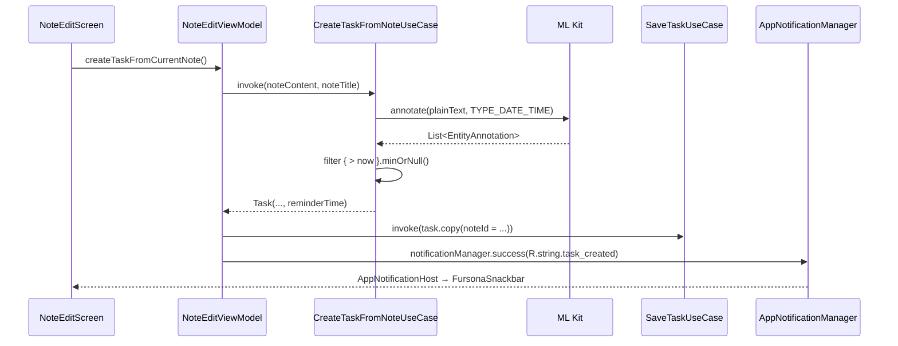
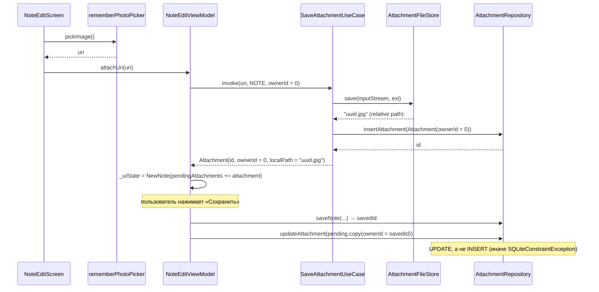
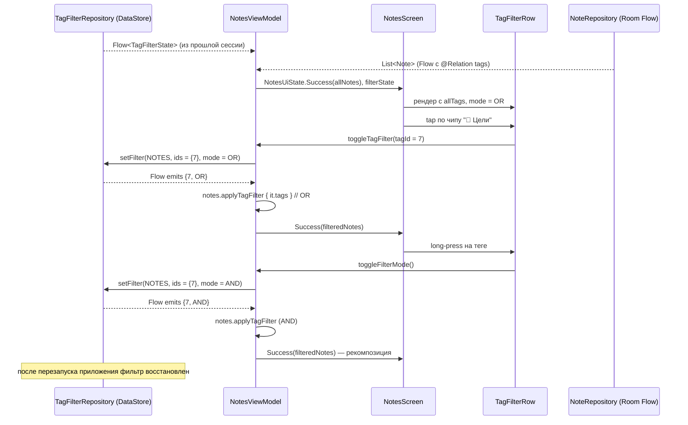
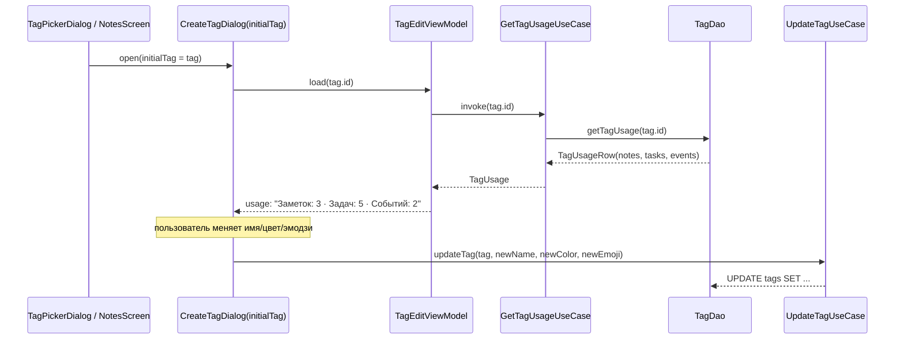

# 🏗 Архитектура PageBook Android

## 🎯 Обзор

PageBook Android следует официальным рекомендациям Google по архитектуре
приложений и использует **Clean Architecture** с тремя слоями:

- **UI Layer** — Compose + ViewModel + UI State.
- **Domain Layer** — Use Cases, доменные модели, интерфейсы репозиториев.
- **Data Layer** — Room, DAO, реализации репозиториев, мапперы, DataStore, файловое хранилище.

Внедрение зависимостей — **Hilt** (`@HiltAndroidApp`, `@HiltViewModel`,
`@Binds`-модули в `data/di/`).

Навигация — **type-safe** на основе `@Serializable` destinations
(Navigation Compose 2.8+), с поддержкой **адаптивных лейаутов**
(`NavigationSuiteScaffold` для BottomBar/Rail, `ListDetailPaneScaffold`
для планшетов).

> **Статус миграции:** Clean Architecture полностью внедрена для всех трёх
> модулей — **Notes**, **Tasks** и **Events (Calendar)**. Все три БД объединены
> в одну `PageBookDatabase` (version 4). Сквозная система **тегов с кастомизацией
> цвета и эмодзи** доведена до полноценного UX: **фильтрация списков** (OR/AND,
> persist через DataStore, badge с count), **редактирование тегов** и **счётчик
> использования**. Добавлена **подсистема вложений** (изображения + файлы,
> app-private storage, MediaStore), **глобальная система уведомлений**
> (кастомный `Snackbar` с аватаром-фурсоной) и **пасхалка** в настройках.
> UI переведён на Material 3 Expressive, локализован на `ru`/`en`,
> добавлена адаптивность под планшеты.

## 🛠 Технологический стек

| Компонент           | Технология                                                    | Версия         |
|:--------------------|:--------------------------------------------------------------|:---------------|
| Язык                | Kotlin                                                        | 2.2.20         |
| UI                  | Jetpack Compose + **Material 3 Expressive**                   | BOM 2026.09.00 |
| Архитектура         | Clean Architecture (UI/Domain/Data)                           | —              |
| Локальное хранилище | Room (одна БД `pagebook.db`)                                  | 2.7.2          |
| Rich text           | RichEditor (Compose Multiplatform)                            | —              |
| Файловое хранилище  | App-private (`filesDir/attachments/`) + MediaStore (download) | —              |
| Настройки           | DataStore Preferences (**тема + фильтры тегов**)              | 1.2.1          |
| Язык приложения     | `AppCompatDelegate.setApplicationLocales()`                   | appcompat 1.7  |
| Асинхронность       | Coroutines & Flow + `Channel` для one-shot событий            | 1.10.2         |
| DI                  | **Hilt** (`@Binds` + `@Provides`)                             | 2.56.2         |
| Навигация           | Navigation Compose (type-safe) + `material3-adaptive-*`       | 2.9.0          |
| ML                  | **ML Kit Entity Extraction** (beta)                           | 16.0.0-beta6   |
| Сборка              | AGP                                                           | 9.4.1          |
| SDK                 | compileSdk 37 / targetSdk 36 / minSdk 28                      | —              |
| JDK                 | Java 21                                                       | —              |

## 📂 Структура пакетов

```text
ru.maxgog.pagebook
├── PageBookApplication.kt        # @HiltAndroidApp
├── MainActivity.kt               # AppCompatActivity + enableEdgeToEdge() + setContent
├── Converters.kt                 # LocalDate ↔ String + toKotlinxLocalDate()
│
├── core/
│   └── notification/             # AppNotification, AppNotificationManager,
│                                 #   AppNotificationType (SUCCESS/ERROR/INFO/EASTER_EGG)
│
├── data/
│   ├── dao/                      # NoteDao, TaskDao, EventDao, TagDao (+ TagUsageRow)
│   ├── local/                    # AttachmentDao, AttachmentEntity
│   ├── models/                   # Entity-классы + @Relation-обёртки
│   ├── rooms/                    # PageBookDatabase, Migrations
│   ├── file/                     # AttachmentFileStore, MediaStoreDownloader
│   ├── mapper/                   # NoteMapper, TaskMapper, EventMapper, TagMapper,
│   │                             #   AttachmentMapper
│   ├── repository/               # *RepositoryImpl, SettingsRepository,
│   │                             #   TagFilterRepositoryImpl (DataStore)
│   └── di/                       # DatabaseModule, RepositoryModule,
│                                 #   DataStoreModule, AttachmentsModule
│
├── domain/
│   ├── model/                    # Note, Task, Event, Tag, TagColor,
│   │                             #   Attachment, AttachmentType, OwnerType,
│   │                             #   TagFilterState, FilterMode, TagFilterModule,
│   │                             #   TagUsage
│   ├── repository/               # Интерфейсы репозиториев
│   ├── usecase/                  # note/, task/, event/, tag/, attachment/
│   └── util/                     # TagFilterExt.kt (applyTagFilter)
│
└── ui/
    ├── app/                      # CombinedApp — NavigationSuiteScaffold,
    │                             #   MainViewModel (провайдер AppNotificationManager)
    ├── navigation/               # Destinations.kt, AppNavHost.kt, BottomNavBar.kt
    ├── notification/             # AppNotificationHost, FursonaSnackbar,
    │                             #   FursonaSnackbarVisuals
    ├── components/               # TagChip (+onEdit/onLongClick), CompactTagChip,
    │                             #   CreateTagDialog (create/edit), TagPickerDialog
    │                             #   (+onEditTag), TagFilterRow (+mode toggle),
    │                             #   FilterBadgeIcon, TagEditViewModel,
    │                             #   EmojiCatalog, EmojiPickerDialog, OverflowMenu,
    │                             #   AttachmentPreviewList, AttachmentImageLoader,
    │                             #   AttachmentPicker, ResizeImageDialog
    ├── notes/                    # NotesScreen, NoteEditScreen + ViewModels + UiStates + NoteItem
    ├── tasks/                    # TaskListScreen, TaskEditScreen, TaskItem,
    │                             #   TaskListDetailPane + ViewModels + UiStates
    ├── calendar/                 # CalendarScreen, AddEventDialog, DateTimePickerDialog,
    │                             #   EventItem, CalendarViewModel
    ├── settings/                 # SettingsScreen, SettingsViewModel, AppLanguage,
    │                             #   ThemePreference, LanguagePreference,
    │                             #   SettingsGroup, FursonaEasterEgg
    └── theme/                    # Color, Type, Theme, AppTheme (enum ThemeMode)
```

## 💾 Единая база данных `PageBookDatabase`

Проект использует **одну `RoomDatabase`** с **восемью сущностями** — это
необходимое условие для сквозной системы тегов через `ForeignKey` и
хранения вложений с общим `ownerType`/`ownerId` для заметок и задач.

```kotlin
@Database(
    entities = [
        NoteModel::class, TaskModel::class, EventModel::class, TagModel::class,
        NoteTagCrossRef::class, TaskTagCrossRef::class, EventTagCrossRef::class,
        AttachmentEntity::class
    ],
    version = 4,
    exportSchema = true
)
abstract class PageBookDatabase : RoomDatabase() {
    abstract fun noteDao(): NoteDao
    abstract fun taskDao(): TaskDao
    abstract fun eventDao(): EventDao
    abstract fun tagDao(): TagDao
    abstract fun attachmentDao(): AttachmentDao
}
```

### Связи между сущностями

| Связь                        | Реализация                                                                                        |
|:-----------------------------|:--------------------------------------------------------------------------------------------------|
| **Note → Task**              | `TaskModel.noteId` + `Index("NoteId")`. `onDelete = SET_NULL`.                                    |
| **Note ↔ Tag**               | Junction `NoteTagCrossRef` с `onDelete = CASCADE`                                                 |
| **Task ↔ Tag**               | Junction `TaskTagCrossRef` с `onDelete = CASCADE`                                                 |
| **Event ↔ Tag**              | Junction `EventTagCrossRef` с `onDelete = CASCADE`                                                |
| **Attachment → Note / Task** | Полиморфная связь через `ownerType: OwnerType` + `ownerId: Int` + `Index("ownerType", "ownerId")` |

## 🏷️ Система тегов

Теги — **сквозная фича**, кастомизируются цветом (7 вариантов) и
опциональным эмодзи (200+ в 10 категориях). Работают на заметках, задачах
и событиях одновременно через many-to-many (`@Junction`).

### Особенности
- **`emoji: String?`** — опционально. Без эмодзи рисуется цветная точка, с эмодзи — символ в `leadingIcon`.
- **`_pendingTags` / `selectedTags`** — ViewModel накапливает выбранные теги для новых (ещё не сохранённых) сущностей, привязка происходит после `save*`.
- **`EmojiCatalog`** — статический объект (`@StringRes` для категорий), не требует сети.
- **`TagUsage`** — счётчик использования тега (`notes` / `tasks` / `events`), вычисляется через 3 `SELECT COUNT(*)` по junction-таблицам в `TagDao.getTagUsage(tagId)`.

### 🔍 Фильтрация списков по тегам

Единый паттерн во всех трёх модулях (**Notes**, **Tasks**, **Calendar**):

1. **`TagFilterRow`** (`ui/components/`) — горизонтальный `LazyRow`:
   - слева — `AssistChip` режима **`OR`/`AND`** (переключается тапом);
   - далее — `FilterChip` по каждому тегу (`TagChip` с `selected` для выбранных);
   - **long-press на любом теге** тоже переключает режим (`onLongClick` в `TagChip`);
   - в конце — `AssistChip` «Сбросить», если есть выбранные теги.
   - Компонент не рендерится, если `allTags` пуст.
2. **`FilterBadgeIcon`** (`ui/components/`) — `IconButton` с `BadgedBox` в
   `TopAppBar`: показывает `filterState.count` (количество выбранных тегов)
   и по тапу скрывает/показывает `TagFilterRow`. Это избавляет от лишнего
   вертикального пространства, когда фильтр не активен.
3. **`TagFilterState`** (`domain/model/`):
   ```kotlin
   data class TagFilterState(
       val tagIds: Set<Int> = emptySet(),
       val mode: FilterMode = FilterMode.OR  // OR | AND
   )
   ```
4. **`TagFilterRepository`** (DataStore) — persist-фильтра по модулю:
   - `getFilter(module): Flow<TagFilterState>`;
   - `setFilter(module, state)` — пишет `tag_filter_<module>_ids` и `tag_filter_<module>_mode`;
   - `clearFilter(module)` — сбрасывает оба ключа.
   - `module: TagFilterModule` (`NOTES` / `TASKS` / `CALENDAR`) — каждый экран
     помнит свой фильтр независимо.
5. **`applyTagFilter`** (`domain/util/TagFilterExt.kt`) — общая утилита,
   устраняющая дублирование OR/AND между тремя ViewModel:
   ```kotlin
   fun <T> List<T>.applyTagFilter(
       filter: TagFilterState,
       tagsOf: (T) -> List<Tag>
   ): List<T> { /* OR / AND */ }
   ```
6. **OR-логика** — сущность проходит, если у неё есть **хотя бы один** из
   выбранных тегов. **AND-логика** — должны присутствовать **все** выбранные
   теги. Пустой `Set` — фильтр выключен (поведение идентично OR и AND).
7. **Календарь дополнительно**: `CalendarUiState.datesWithEvents: Set<LocalDate>`
   вычисляется из **отфильтрованного** списка → точки-индикаторы на днях
   автоматически сужаются под фильтр. Заодно это исправило баг — раньше
   точка рисовалась только на выбранном дне, а не на всех днях с событиями.
8. **Пустой результат** при активном фильтре → `EmptyState` с
   `R.string.no_matching_items` («Ничего не найдено») вместо
   «Нет заметок / задач / событий».

```kotlin
// Паттерн (NotesViewModel / TaskListViewModel / CalendarViewModel)
val filterState: StateFlow<TagFilterState> = tagFilterRepository
    .getFilter(TagFilterModule.NOTES)
    .stateIn(viewModelScope, SharingStarted.WhileSubscribed(5_000), TagFilterState())

val uiState: StateFlow<NotesUiState> = combine<List<Note>, TagFilterState, NotesUiState>(
    getAllNotesUseCase(),
    filterState
) { notes, filter ->
    NotesUiState.Success(notes.applyTagFilter(filter) { it.tags })
}
    .catch { emit(NotesUiState.Error(it.message ?: "Unknown error")) }
    .stateIn(viewModelScope, SharingStarted.WhileSubscribed(5_000), NotesUiState.Loading)

fun toggleTagFilter(tagId: Int) = viewModelScope.launch {
    val cur = filterState.value
    val newIds = if (tagId in cur.tagIds) cur.tagIds - tagId else cur.tagIds + tagId
    tagFilterRepository.setFilter(TagFilterModule.NOTES, cur.copy(tagIds = newIds))
}

fun toggleFilterMode() = viewModelScope.launch {
    val cur = filterState.value
    val newMode = if (cur.mode == FilterMode.OR) FilterMode.AND else FilterMode.OR
    tagFilterRepository.setFilter(TagFilterModule.NOTES, cur.copy(mode = newMode))
}

fun clearTagFilter() = viewModelScope.launch {
    tagFilterRepository.clearFilter(TagFilterModule.NOTES)
}
```

> **Почему фильтрация в ViewModel, а не SQL-запросом:** список уже
> загружается реактивно из Room вместе с `@Relation tags` — фильтрация
> в памяти бесплатна и не требует новых DAO-запросов. При росте объёма
> данных до десятков тысяч записей имеет смысл перейти на
> `SELECT ... WHERE id IN (SELECT noteId FROM note_tag_cross_ref WHERE tagId IN (...))`
> с `Flow`-подпиской на параметр.

### ✏️ Редактирование тегов и счётчик использования

`CreateTagDialog` работает в двух режимах:

| Режим          | `initialTag` | Заголовок  | Кнопка подтверждения | Usage                                                     |
|:---------------|:-------------|:-----------|:---------------------|:----------------------------------------------------------|
| Создание       | `null`       | `new_tag`  | `create`             | —                                                         |
| Редактирование | `Tag`        | `edit_tag` | `save`               | `tag_usage_format` («Заметок: N · Задач: N · Событий: N») |

- **`TagEditViewModel`** (`ui/components/`) — `@HiltViewModel`, отдельный от
  родительского экрана. При `initialTag != null` подгружает `TagUsage`
  через `GetTagUsageUseCase` и отдаёт в диалог через `usage: StateFlow<TagUsage?>`.
- **`TagChip.onEdit`** — иконка карандаша в `trailingIcon`; отображается
  только если передан колбэк. Это позволяет переиспользовать `TagChip`
  в `TagPickerDialog` (редактирование из редакторов заметок/задач)
  без обязательного показа кнопки.
- **`TagPickerDialog.onEditTag`** — опциональный колбэк, который
  открывает `CreateTagDialog(initialTag = tag, …)` поверх пикера.
  По умолчанию `null` (в `AddEventDialog` сейчас не передаётся).
- **`UpdateTagUseCase`** — валидирует имя (`require(trimmed.isNotEmpty())`),
  копирует `Tag` с новыми `name`/`colorHex`/`emoji`.

## 📎 Подсистема вложений (Attachments)

Вложения поддерживаются и в заметках, и в задачах через **полиморфную
связь** (`ownerType: OwnerType` + `ownerId: Int`). Это позволяет не
плодить отдельные таблицы и один и тот же UI-компонент
(`AttachmentPreviewList`) переиспользовать в обоих редакторах.

### ⚠️ Ключевая особенность: `localPath` — относительный

`AttachmentFileStore.save()` кладёт файл в `filesDir/attachments/<uuid>.<ext>`
и возвращает **относительный** путь (`"<uuid>.<ext>"`), а не абсолютный.
Поэтому **все** места, где нужно прочитать файл, обязаны разрешать путь
относительно корня:

```kotlin
// ✅ Правильно
val file = File(File(context.filesDir, "attachments"), attachment.localPath)

// ❌ Неправильно — ищет файл в корне рабочей директории процесса
val file = File(attachment.localPath)
```

Это правило касается `AttachmentPreviewList.kt`, `AttachmentImageLoader.kt` и `AttachmentFileStore.open()`.

## 🔔 Глобальная система уведомлений (Snackbar)

В приложении реализована **единая точка показа уведомлений**, избавляющая ViewModel от привязки к `Context` и предотвращающая дублирование `SnackbarHost` на каждом экране.

### Архитектура
1. **`AppNotificationManager`** (`@Singleton`, Hilt) — единый менеджер. Использует `Channel<AppNotification>(BUFFERED)` для гарантированной доставки (по принципу One-Shot событий).
2. **`MainActivity`** — единственное место, где инициализируется `SnackbarHostState` и вызывается `AppNotificationHost`. Он подписывается на `events` менеджера и передаёт их в кастомный `SnackbarHost`.
3. **`FursonaSnackbar`** — кастомный UI. Использует `FursonaSnackbarVisuals` для получения типа уведомления (`SUCCESS`, `ERROR`, `INFO`, `EASTER_EGG`).

### 🦊 Особенности дизайна фурсоны
- Фурсона вынесена за пределы фона `Snackbar` (реализовано через `Box` + `Surface` с отступом).
- Используются цвета Material 3 (`secondaryContainer` для успеха, `errorContainer` для ошибок, `tertiaryContainer` для пасхалок).

### Использование в ViewModel
```kotlin
@HiltViewModel
class NoteEditViewModel @Inject constructor(
    private val notificationManager: AppNotificationManager
) : ViewModel() {
    fun save() {
        // ...
        notificationManager.success(R.string.note_saved)
    }
}
```

## 🎨 Адаптивный UI и навигация

### NavigationSuiteScaffold
`CombinedApp` использует `NavigationSuiteScaffold` для автоматического
переключения между `NavigationBar` (телефоны) и `NavigationRail`
(планшеты/Chromebook). Управление видимостью панели — через `scaffoldState.hide()/show()`.

### ListDetailPaneScaffold (Tasks)
На экранах `Expanded` (`WindowWidthSizeClass.Expanded`) список задач и редактор
открываются в `ListDetailPaneScaffold` (два пена рядом). На телефонах —
обычная навигация `navController.navigate(TaskEditDestination(id))`.

### Google Keep-style Note Editor
`NoteEditScreen`:
- `BasicTextField` без рамки для заголовка.
- Теги в `FlowRow` (переносятся на новую строку).
- Превью вложений (`AttachmentPreviewList`) над редактором.
- `RichTextEditor` на `weight(1f)`.
- `FormattingToolbar` использует `windowInsetsPadding(WindowInsets.navigationBars.union(WindowInsets.ime))` — тулбар **всегда над клавиатурой**.
- Кнопки «Фото» и «Файл» в `TopAppBar` — через `rememberPhotoPicker` / `rememberFilePicker`.

## ⚡ One-Shot Events (Channel)

Для навигации после сохранения/удаления вместо `StateFlow<Boolean>`
используется `Channel<T>(Channel.BUFFERED)` + `receiveAsFlow()`.
Это гарантирует доставку события **ровно один раз** и устраняет race condition.

```kotlin
// ViewModel
private val _events = Channel<TaskEditEvent>(Channel.BUFFERED)
val events = _events.receiveAsFlow()

// UI
LaunchedEffect(Unit) {
    viewModel.events.collect { event ->
        when (event) {
            TaskEditEvent.Saved, TaskEditEvent.Deleted -> onBack()
        }
    }
}
```

## ⚙️ Настройки (DataStore + AppCompatDelegate)

Настройки разделены на две зоны ответственности:
1.  **Тема** — хранится в `DataStore<Preferences>` (`SettingsRepository`). Читается через `ThemeViewModel` в `MainActivity` (реактивно).
2.  **Язык** — единый источник правды `AppCompatDelegate.getApplicationLocales()`. Выбор применяется через `AppLanguage.apply()`.

### UI в стиле Material 3 Expressive
- Группы настроек обёрнуты в `Card` с `RoundedCornerShape(28.dp)`.
- Внутри — `ListItem` с `Color.Transparent`.
- Под каждым пунктом — `supportingContent` с пояснением (`theme_system_desc`, `language_ru_desc` и т.д.).
- В `TopAppBar` всех главных экранов добавлено `OverflowMenu` (три точки) с пунктом «Настройки».

### 🥚 Пасхалка и аватар разработчика
- **Аватар разработчика**: добавлен в `AboutSettings` через `leadingContent` у `ListItem`.
- **Пасхалка**: при 7 быстрых тапах (с паузой не более 1 сек) по номеру версии появляется карточка `FursonaEasterEgg` с анимацией, а также отправляется `EASTER_EGG`-уведомление.

## 🔄 Поток данных (примеры)

### Создание задачи из заметки (ML Kit)


### Прикрепление файла к новой заметке


### Фильтрация списка по тегу (persist + OR/AND)


### Редактирование тега с usage


## 🧭 Ключевые архитектурные решения

| Решение                                                                      | Обоснование                                                                                                   |
|:-----------------------------------------------------------------------------|:--------------------------------------------------------------------------------------------------------------|
| **Clean Architecture**                                                       | UI не зависит от схемы БД; Use Cases инкапсулируют бизнес-логику.                                             |
| **Repository как интерфейс**                                                 | Позволяет подменить источник данных без изменения Domain/UI.                                                  |
| **UI State (sealed / data class)**                                           | Явные состояния `Loading`/`Success`/`Error` — предсказуемое поведение.                                        |
| **One-Shot Events (`Channel`)**                                              | Гарантирует однократный вызов `onBack()` после сохранения.                                                    |
| **Глобальный `SnackbarHost` + `Channel`**                                    | Избавляет ViewModel от `Context`, гарантирует доставку, убирает дублирование `SnackbarHost` на каждом экране. |
| **Hilt**                                                                     | Масштабируемый DI, генерируемый на этапе компиляции.                                                          |
| **Type-safe navigation**                                                     | Компилятор проверяет маршруты и аргументы.                                                                    |
| **`AppCompatDelegate` для языка**                                            | Единый источник правды, работающий на всех версиях Android.                                                   |
| **Полиморфные вложения (`ownerType` + `ownerId`)**                           | Одна таблица и один UI-компонент для Notes и Tasks.                                                           |
| **`localPath` — относительный путь**                                         | Отвязка от абсолютного `filesDir` (меняется между установками/бэкапами).                                      |
| **`@Update` для pending-вложений**                                           | Избегаем `SQLiteConstraintException` при повторном `insert` с тем же `id`.                                    |
| **`TagFilterRepository` на DataStore**                                       | Фильтр переживает перезапуск; каждый модуль (`NOTES`/`TASKS`/`CALENDAR`) помнит свой `tagIds + mode`.         |
| **`TagFilterState(tagIds, mode)` в Domain**                                  | Тип-безопасное представление фильтра; легко расширять (например, `FilterMode.NOT`), не ломая ViewModel.       |
| **`applyTagFilter` — общая утилита в `domain/util`**                         | Устраняет дублирование OR/AND между тремя ViewModel; тестируется один раз.                                    |
| **Long-press на `TagChip` + `AssistChip` OR/AND**                            | Два пути переключения режима: быстрый (long-press) и явный (чип) для новичков.                                |
| **`FilterBadgeIcon` в `TopAppBar`**                                          | Показывает `count`, а не весь ряд фильтров, — экономит вертикальное место, когда фильтр не активен.           |
| **`datesWithEvents` из отфильтрованного списка**                             | Точки-индикаторы в календаре автоматически сужаются под фильтр, без дублирования логики.                      |
| **`TagEditViewModel` отдельно от экрана**                                    | Диалог редактирования тега можно открыть из любого места (Notes/Tasks/Calendar) с идентичным UX.              |
| **`TagUsage` из 3 `COUNT(*)` в `TagDao`**                                    | Один SQL-запрос вместо трёх последовательных; junction-таблицы уже проиндексированы по `tagId`.               |
| **Адаптивные лейауты (`NavigationSuiteScaffold`, `ListDetailPaneScaffold`)** | Соответствие гайдлайнам Google для телефонов, планшетов и Chromebook.                                         |
| **M3 Expressive (`Card`, `ListItem`)**                                       | Современный вид без alpha-зависимостей.                                                                       |
| **`@StringRes` в ViewModel**                                                 | Snackbar-сообщения локализуются без утечек `Context`.                                                         |
| **Кастомный `Snackbar` с фурсоной**                                          | Единый стиль уведомлений, брендинг, M3 Expressive (`Surface` + `Box` для выхода за рамки).                    |

## 🚀 Планы по развитию

- [x] Внедрить **Hilt** для DI.
- [x] Выделить **Domain Layer** (Use Cases) для всех модулей.
- [x] Подключить **ML Kit** для извлечения дат.
- [x] Объединить три БД в `PageBookDatabase`.
- [x] Добавить **сквозную систему тегов** (7 цветов, many-to-many, эмодзи).
- [x] Добавить **фильтрацию списков по тегам** (Notes / Tasks / Calendar) — `TagFilterRow`, `datesWithEvents` в календаре.
- [x] **Сохранение фильтра** между перезапусками — `TagFilterRepository` на `DataStore`, ключи `tag_filter_<module>_ids/mode`.
- [x] **AND-логика фильтра** — `FilterMode.OR/AND`, long-press на теге + `AssistChip`.
- [x] **Счётчик выбранных тегов** в `TopAppBar` — `FilterBadgeIcon` + `Badge`.
- [x] **Редактирование существующих тегов** — `CreateTagDialog(initialTag = …)`, `TagPickerDialog.onEditTag`, `TagEditViewModel`.
- [x] **Счётчик использования тега** — `TagDao.getTagUsage(tagId)` + `TagUsage` в диалоге редактирования.
- [x] Реализовать **адаптивный UI** (BottomBar/Rail, два пена на планшетах).
- [x] Перевести UI на **Material 3 Expressive** + локализация (`ru`/`en`).
- [x] Починить смену языка через **`AppCompatDelegate`**.
- [x] Добавить **One-Shot Events** через `Channel`.
- [x] Добавить **подсистему вложений** (изображения + файлы, общая для Notes и Tasks).
- [x] Внедрить **глобальную систему уведомлений** с фурсоной (`AppNotificationManager` + `FursonaSnackbar`).
- [x] Добавить **пасхалку** и аватар разработчика в настройки.
- [ ] Поиск по эмодзи в `EmojiPickerDialog`.
- [ ] Недавние эмодзи (последние 20 в `DataStore`).
- [ ] Просмотр вложений на весь экран (fullscreen viewer).
- [ ] Камера как источник изображения (сейчас только галерея).
- [ ] **Мультиверсионные заметки для соцсетей** — несколько версий одной
    заметки, адаптированных под разные платформы. Возможная реализация:
    отдельная сущность `NoteVariant` (`noteId`, `platform`, `title`,
    `content`, `attachments`-override) + `@Relation` в `NoteModel`;
    переключение версий в `NoteEditScreen` через чипы/таб.
- [ ] `ListDetailPaneScaffold` для Notes и Calendar (аналогично Tasks).
- [ ] `MIGRATION_3_4` для `attachments` (сейчас `fallbackToDestructiveMigration`).
- [ ] Модуляризация (feature-модули).
- [ ] Unit-тесты для Use Cases и Repository (включая `AttachmentRepository`, `applyTagFilter`, `TagFilterRepositoryImpl`).

## 📚 Полезные ссылки
- [Guide to App Architecture (Google)](https://developer.android.com/topic/architecture)
- [Building adaptive apps with Jetpack Compose](https://developer.android.com/develop/ui/compose/layouts/adaptive)
- [Per-app language preferences](https://developer.android.com/guide/topics/resources/app-languages)
- [Now in Android (официальный референс)](https://github.com/android/nowinandroid)
- [Navigation — type safety](https://developer.android.com/guide/navigation/design/type-safety)
- [ML Kit Entity Extraction](https://developers.google.com/ml-kit/language/entity-extraction)
- [Room — Relationships](https://developer.android.com/training/data-storage/room/relationships)
- [DataStore — Preferences](https://developer.android.com/topic/libraries/architecture/datastore)
- [Hilt — `@Binds`](https://developer.android.com/training/dependency-injection/hilt-android#hilt-modules)
- [MediaStore — Download files](https://developer.android.com/training/data-storage/shared/media)
- [Photo picker](https://developer.android.com/training/data-storage/shared/photopicker)
- [Compose — FilterChip](https://developer.android.com/develop/ui/compose/components/chip#filter-chip)
- [Compose — Badge](https://developer.android.com/develop/ui/compose/components/badge)
- [Material 3 — Long press / combined gestures](https://developer.android.com/develop/ui/compose/touch-input/pointer-input/drag-swipe-fling)