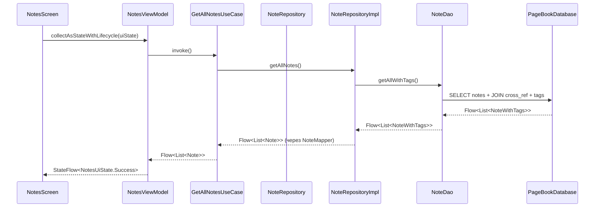
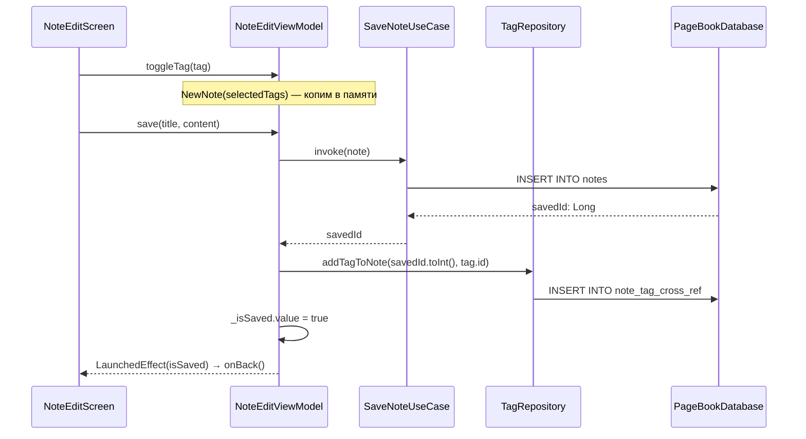
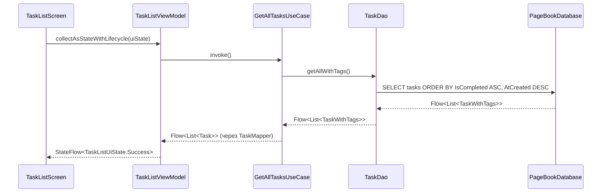
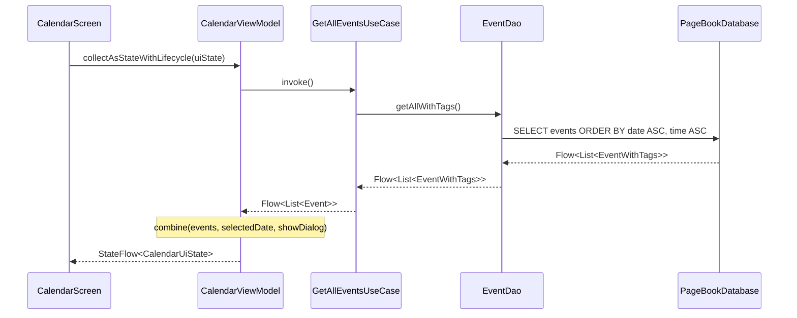
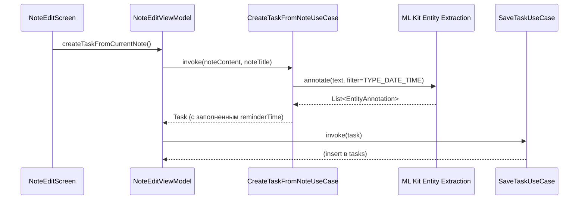

# 🏗 Архитектура PageBook Android

## 🎯 Обзор

PageBook Android следует официальным рекомендациям Google по архитектуре
приложений и использует **Clean Architecture** с тремя слоями:

- **UI Layer** — Compose + ViewModel + UI State.
- **Domain Layer** — Use Cases, доменные модели, интерфейсы репозиториев.
- **Data Layer** — Room, DAO, реализации репозиториев, мапперы, DataStore.

Внедрение зависимостей — **Hilt** (`@HiltAndroidApp`, `@HiltViewModel`,
`@Binds`-модули в `data/di/`).

Навигация — **type-safe** на основе `@Serializable` destinations
(Navigation Compose 2.8+).

> **Статус миграции:** Clean Architecture полностью внедрена для всех трёх
> модулей — **Notes**, **Tasks** и **Events (Calendar)**. Todos переименованы
> в Tasks и получили связь с заметками через `noteId`. Все три БД объединены
> в одну `PageBookDatabase`. Добавлена сквозная система **цветных тегов**,
> общая для заметок, задач и событий.

## 🛠 Технологический стек

| Компонент           | Технология                               | Версия         |
|:--------------------|:-----------------------------------------|:---------------|
| Язык                | Kotlin                                   | 2.2.20         |
| UI                  | Jetpack Compose + Material 3             | BOM 2026.09.00 |
| Архитектура         | Clean Architecture (UI/Domain/Data)      | —              |
| Локальное хранилище | Room (одна БД `pagebook.db`)             | 2.7.2          |
| Настройки           | DataStore Preferences                    | 1.2.1          |
| Асинхронность       | Coroutines & Flow                        | 1.10.2         |
| DI                  | **Hilt** (`@Binds` + `@Provides`)        | 2.56.2         |
| Навигация           | Navigation Compose (type-safe)           | 2.9.0          |
| ML                  | **ML Kit Entity Extraction** (beta)      | 16.0.0-beta6   |
| Сборка              | AGP                                      | 9.4.1          |
| SDK                 | compileSdk 37 / targetSdk 36 / minSdk 28 | —              |
| JDK                 | Java 21                                  | —              |

## 📂 Структура пакетов

```
ru.maxgog.pagebook
├── PageBookApplication.kt        # @HiltAndroidApp
├── MainActivity.kt               # enableEdgeToEdge() + setContent { ... }
├── Converters.kt                 # LocalDate ↔ String
│
├── data/
│   ├── dao/                      # NoteDao, TaskDao, EventDao, TagDao
│   ├── models/                   # Entity-классы + @Relation-обёртки
│   │   ├── NoteModel, TaskModel, EventModel, TagModel
│   │   ├── NoteTagCrossRef, TaskTagCrossRef, EventTagCrossRef
│   │   └── NoteWithTags, TaskWithTags, EventWithTags
│   ├── rooms/
│   │   └── PageBookDatabase.kt   # Единая БД: 7 entities, version = 2
│   ├── mapper/                   # NoteMapper, TaskMapper, EventMapper, TagMapper
│   ├── repository/               # NoteRepositoryImpl, TaskRepositoryImpl,
│   │                             #   EventRepositoryImpl, TagRepositoryImpl,
│   │                             #   SettingsRepository
│   └── di/
│       ├── DatabaseModule.kt     # PageBookDatabase + 4 DAO
│       ├── RepositoryModule.kt   # @Binds: интерфейс → реализация (4 шт.)
│       └── DataStoreModule.kt    # DataStore<Preferences>
│
├── domain/
│   ├── model/                    # Note, Task, Event, Tag, TagColor
│   ├── repository/               # NoteRepository, TaskRepository,
│   │                             #   EventRepository, TagRepository (интерфейсы)
│   └── usecase/
│       ├── note/                 # GetAllNotes, GetNoteById, SaveNote, DeleteNote
│       ├── task/                 # GetAllTasks, GetTaskById, SaveTask,
│       │                         #   DeleteTask, CreateTaskFromNote
│       ├── event/                # GetAllEvents, SaveEvent, DeleteEvent
│       └── tag/                  # GetAllTags, CreateTag, UpdateTag, DeleteTag,
│                                 #   GetTagsFor{Note,Task,Event},
│                                 #   ToggleTagOn{Note,Task,Event}
│
└── ui/
├── app/                      # CombinedApp — корневой Scaffold
├── navigation/               # Destinations.kt, AppNavHost.kt, BottomNavBar.kt
├── components/               # TagChip, CompactTagChip,
│                             #   CreateTagDialog, TagPickerDialog
├── notes/                    # NotesScreen + ViewModel + UiState + NoteItem
├── note_edit/                # NoteEditScreen + ViewModel + UiState
├── tasks/                    # TaskListScreen, TaskEditScreen, TaskItem,
│                             #   ViewModels, UiStates
├── calendar/                 # CalendarScreen, AddEventDialog,
│                             #   DateTimePickerDialog, EventItem,
│                             #   ViewModel, UiState
├── settings/                 # SettingsScreen, SettingsViewModel,
│                             #   ThemePreference, LanguagePreference,
│                             #   SettingsSection
└── theme/                    # Color, Type, Theme, AppTheme (enum ThemeMode)
```

## 💾 Единая база данных `PageBookDatabase`

Проект использует **одну `RoomDatabase`** с семью сущностями — это
необходимое условие для сквозной системы тегов через `ForeignKey`.

```kotlin
@Database(
    entities = [
        NoteModel::class,
        TaskModel::class,
        EventModel::class,
        TagModel::class,
        NoteTagCrossRef::class,
        TaskTagCrossRef::class,
        EventTagCrossRef::class
    ],
    version = 2,
    exportSchema = true
)
abstract class PageBookDatabase : RoomDatabase() {
    abstract fun noteDao(): NoteDao
    abstract fun taskDao(): TaskDao
    abstract fun eventDao(): EventDao
    abstract fun tagDao(): TagDao
}
```

### Связи между сущностями

| Связь           | Реализация                                                                                        |
|:----------------|:--------------------------------------------------------------------------------------------------|
| **Note → Task** | `TaskModel.noteId` + `Index("NoteId")`. `onDelete = SET_NULL` (задача остаётся, но теряет связь). |
| **Note ↔ Tag**  | Junction `NoteTagCrossRef` с `onDelete = CASCADE`                                                 |
| **Task ↔ Tag**  | Junction `TaskTagCrossRef` с `onDelete = CASCADE`                                                 |
| **Event ↔ Tag** | Junction `EventTagCrossRef` с `onDelete = CASCADE`                                                |

> **Почему одна БД:** `ForeignKey` в Room работает только внутри одной
> `@Database`. При трёх отдельных БД (`notes_db`, `tasks_db`, `events_db`)
> теги пришлось бы дублировать или синхронизировать вручную. Одна БД решает
> проблему элегантно: `NoteWithTags`, `TaskWithTags`, `EventWithTags`
> через `@Transaction` + `@Relation` загружаются одним запросом без N+1.

## 🏷️ Система тегов

Теги — **сквозная фича**: один и тот же тег может быть привязан к заметке,
задаче и событию одновременно. Это реализовано как **many-to-many** через
три junction-таблицы.

### Модели

| Слой   | Модель               | Поля                                                                         |
|:-------|:---------------------|:-----------------------------------------------------------------------------|
| Domain | `Tag`                | `id: Int`, `name: String`, `colorHex: String`                                |
| Domain | `TagColor` (enum)    | 7 цветов macOS: `RED`, `ORANGE`, `YELLOW`, `GREEN`, `BLUE`, `PURPLE`, `GRAY` |
| Data   | `TagModel` (@Entity) | `id`, `Name`, `ColorHex`                                                     |
| Data   | `NoteTagCrossRef`    | `noteId`, `tagId` (composite PK)                                             |
| Data   | `TaskTagCrossRef`    | `taskId`, `tagId` (composite PK)                                             |
| Data   | `EventTagCrossRef`   | `eventId`, `tagId` (composite PK)                                            |

### Use Cases

| Use Case                  | Вход                     | Выход              | Назначение                             |
|:--------------------------|:-------------------------|:-------------------|:---------------------------------------|
| `GetAllTagsUseCase`       | —                        | `Flow<List<Tag>>`  | Список всех тегов для picker'а         |
| `CreateTagUseCase`        | `name, color`            | `Long` (id)        | Создать тег с валидацией               |
| `UpdateTagUseCase`        | `tag, newName, newColor` | —                  | Переименовать / сменить цвет           |
| `DeleteTagUseCase`        | `tag`                    | —                  | Удалить (каскадно снимет все привязки) |
| `GetTagsForNoteUseCase`   | `noteId`                 | `Flow<List<Tag>>`  | Теги заметки                           |
| `GetTagsForTaskUseCase`   | `taskId`                 | `Flow<List<Tag>>`  | Теги задачи                            |
| `GetTagsForEventUseCase`  | `eventId`                | `Flow<List<Tag>>`  | Теги события                           |
| `ToggleTagOnNoteUseCase`  | `noteId, tag`            | `Boolean` (added?) | Переключить тег на заметке             |
| `ToggleTagOnTaskUseCase`  | `taskId, tag`            | `Boolean` (added?) | Переключить тег на задаче              |
| `ToggleTagOnEventUseCase` | `eventId, tag`           | `Boolean` (added?) | Переключить тег на событии             |

### UI-компоненты

| Компонент         | Где используется                                     | Описание                                                |
|:------------------|:-----------------------------------------------------|:--------------------------------------------------------|
| `TagChip`         | Редакторы, `TagPickerDialog`                         | `FilterChip` с цветным кружком и опциональной кнопкой × |
| `CompactTagChip`  | `NoteItem`, `TaskItem`, `EventItem`                  | Компактная цветная «плашка» для карточек в списках      |
| `CreateTagDialog` | Везде через `TagPickerDialog`                        | Диалог с полем имени и палитрой из 7 цветов             |
| `TagPickerDialog` | `NoteEditScreen`, `TaskEditScreen`, `AddEventDialog` | Список всех тегов с `FilterChip` + кнопка «Создать тег» |

### Особенность: теги для новой сущности

Если заметка/задача/событие ещё не сохранены (`id == 0`), привязать тег
напрямую нельзя — нет `id`. Решение: ViewModel накапливает выбранные теги
в `selectedTags` (`NewNote`, `NewTask`) или `_pendingTags` (`CalendarViewModel`),
а после `save*` (когда `id` сгенерирован Room) — привязывает через
`tagRepository.addTagTo*`.

## 🔄 Поток данных

### Пример 1: список заметок с тегами (Notes)



**Особенность:** `getAllWithTags()` — `@Transaction`-запрос с `@Relation`,
теги загружаются одним SQL-запросом, без N+1.

### Пример 2: создание заметки с тегами



**Особенность:** экран закрывается **только после** завершения сохранения
и привязки тегов — через `_isSaved: StateFlow<Boolean>` и `LaunchedEffect`.
Это устраняет race condition, когда `onBack()` вызывался сразу после
`viewModel.save()`, и ViewModel уничтожался раньше, чем корутина завершалась.

### Пример 3: список задач (Tasks)



**Особенность:** сортировка `IsCompleted ASC, AtCreated DESC` — незавершённые
сверху, внутри группы новые первыми.

### Пример 4: календарь (Events)



**Особенность:** UI-состояние собирается через `combine` трёх источников —
список событий, выбранная дата, флаг диалога. Фильтрация «события выбранного
дня» — во ViewModel, UI получает готовый `eventsForSelectedDate`.

### Пример 5: создание задачи из заметки через ML Kit



## 🎨 Настройки (DataStore)

Настройки темы и языка хранятся в `DataStore<Preferences>`:

- `SettingsRepository` (data/repository) читает/пишет `theme_mode` и `app_language`.
- `DataStoreModule` (Hilt) предоставляет singleton `DataStore<Preferences>`.
- `MainActivity` подписан на `themeMode` через `ThemeViewModel` — тема
  переключается реактивно, без перезапуска.
- `SettingsViewModel.setLanguage()` вызывает
  `AppCompatDelegate.setApplicationLocales()` — на Android 13+ через
  системный `LocaleManager`, на более старых — через AppCompat.

## 🧭 Ключевые архитектурные решения

| Решение                                          | Обоснование                                                                            |
|:-------------------------------------------------|:---------------------------------------------------------------------------------------|
| **Clean Architecture**                           | UI не зависит от схемы БД; Use Cases инкапсулируют бизнес-логику; легко тестировать.   |
| **Repository как интерфейс**                     | Позволяет подменить источник данных (например, добавить сеть) без изменения Domain/UI. |
| **UI State (sealed / data class)**               | Явные состояния `Loading`/`Success`/`Error` — предсказуемое поведение.                 |
| **Hilt**                                         | Масштабируемый DI, генерируемый на этапе компиляции.                                   |
| **`@Binds` вместо `@Provides` для репозиториев** | Меньше boilerplate: Hilt сам вызывает конструктор реализации.                          |
| **Type-safe navigation**                         | Компилятор проверяет маршруты и аргументы.                                             |
| **`collectAsStateWithLifecycle()`**              | Подписка живёт только пока экран видим.                                                |
| **`contentPadding` в LazyColumn/Grid**           | Правильный edge-to-edge.                                                               |
| **Одна `PageBookDatabase`**                      | Необходимо для `ForeignKey` между Note/Task/Event и Tag.                               |
| **Junction-таблицы для тегов**                   | Классический many-to-many; каскадное удаление через `onDelete = CASCADE`.              |
| **`_pendingTags` / `selectedTags`**              | Обходной путь для привязки тегов к ещё не сохранённым сущностям.                       |
| **`_isSaved: StateFlow<Boolean>`**               | Экран закрывается только после завершения сохранения — нет race condition.             |
| **`combine` во ViewModel**                       | Множественные источники (список + выбранная дата + флаг) — один `StateFlow`.           |
| **ML Kit для извлечения дат**                    | Не требует ручного ввода; `TYPE_DATE_TIME` покрывает большинство форматов.             |
| **DataStore для настроек**                       | Асинхронно, реактивно, не блокирует UI (в отличие от `SharedPreferences`).             |

## 🧩 Особенности отдельных модулей

### Notes

- **Rich Text** — HTML через `richeditor-compose`.
- **Адаптивная сетка** — `StaggeredGridCells.Adaptive(minSize = 160.dp)`.
- **Теги на карточке** — до 3 `CompactTagChip` + `+N`.
- **Удаление** — каскадно удаляет `NoteTagCrossRef` (через `onDelete = CASCADE`).
  Задачи теряют `noteId` (`SET_NULL`), но остаются.

### Tasks

- **Связь с заметками** — `noteId` (nullable). `TaskEditScreen` показывает
  `«Связана с заметкой #N»`, если `noteId != null`.
- **Сортировка** — `IsCompleted ASC, AtCreated DESC`.
- **Создание из заметки** — `CreateTaskFromNoteUseCase` через ML Kit
  (UI пока не подключён — в roadmap).
- **Теги на карточке** — до 3 `CompactTagChip` + `+N`.

### Calendar

- **Реактивность** — `EventDao.getAllWithTags(): Flow`.
- **Автоскролл** — `LaunchedEffect(uiState.selectedDate)` скроллит календарь
  к месяцу выбранного дня.
- **Фильтрация во ViewModel** — через `combine`, UI получает готовый список.
- **Теги в диалоге** — `AddEventDialog` содержит кнопку «Добавить теги»,
  открывающую `TagPickerDialog`. `pendingTags` сбрасываются при отмене или
  после сохранения.

## 🚀 Планы по развитию

- [x] Внедрить **Hilt** для DI (`@Binds` + `@Provides`).
- [x] Выделить **Domain Layer** (Use Cases) для Notes, Tasks, Events.
- [x] Переименовать Todo → Task.
- [x] Подключить **ML Kit** для извлечения дат из заметок.
- [x] Объединить три БД в одну `PageBookDatabase`.
- [x] Добавить **сквозную систему тегов** (7 цветов, many-to-many).
- [x] Добавить `DataStore` для настроек (тема, язык).
- [ ] Реализовать UI для `CreateTaskFromNoteUseCase` в `NoteEditScreen`.
- [ ] Фильтрация списков по тегам (Notes / Tasks / Calendar).
- [ ] Редактирование существующих тегов (имя/цвет) в UI.
- [ ] Модуляризация (feature-модули).
- [ ] Unit-тесты для Use Cases и Repository.
- [ ] WorkManager для напоминаний о задачах.
- [ ] Синхронизация с облаком.

## 📚 Полезные ссылки

- [Guide to App Architecture (Google)](https://developer.android.com/topic/architecture)
- [Now in Android (официальный референс)](https://github.com/android/nowinandroid)
- [Navigation — type safety](https://developer.android.com/guide/navigation/design/type-safety)
- [ML Kit Entity Extraction](https://developers.google.com/ml-kit/language/entity-extraction)
- [Room — Relationships](https://developer.android.com/training/data-storage/room/relationships)
- [Room — Foreign Keys](https://developer.android.com/training/data-storage/room/relationships#foreign-keys)
- [DataStore — Preferences](https://developer.android.com/topic/libraries/architecture/datastore)
- [Hilt — `@Binds`](https://developer.android.com/training/dependency-injection/hilt-android#hilt-modules)