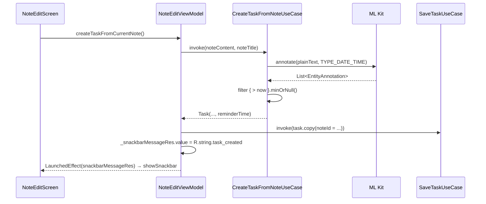
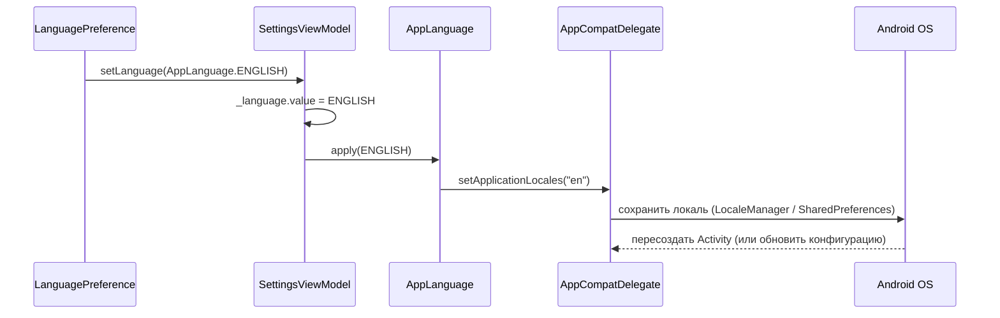

# 🏗 Архитектура PageBook Android

## 🎯 Обзор

PageBook Android следует официальным рекомендациям Google по архитектуре
приложений и использует **Clean Architecture** с тремя слоями:

- **UI Layer** — Compose + ViewModel + UI State.
- **Domain Layer** — Use Cases, доменные модели, интерфейсы репозиториев.
- **Data Layer** — Room, DAO, реализации репозиториев, мапперы, DataStore.

Внедрение зависимостей — **Hilt** (`@HiltAndroidApp`, `@HiltViewModel`,
`@Binds`-модули в `data/di/`).

Навигация — **type-safe** на основе `@Serializable` destinations
(Navigation Compose 2.8+), с поддержкой **адаптивных лейаутов** 
(`NavigationSuiteScaffold` для BottomBar/Rail, `ListDetailPaneScaffold` 
для планшетов).

> **Статус миграции:** Clean Architecture полностью внедрена для всех трёх
> модулей — **Notes**, **Tasks** и **Events (Calendar)**. Все три БД объединены
> в одну `PageBookDatabase` (version 3). Добавлена сквозная система
> **тегов с кастомизацией цвета и эмодзи**. UI переведён на Material 3 Expressive,
> локализован на `ru`/`en`, добавлена адаптивность под планшеты.

## 🛠 Технологический стек

| Компонент           | Технология                                                    | Версия         |
|:--------------------|:--------------------------------------------------------------|:---------------|
| Язык                | Kotlin                                                        | 2.2.20         |
| UI                  | Jetpack Compose + **Material 3 Expressive**                   | BOM 2026.09.00 |
| Архитектура         | Clean Architecture (UI/Domain/Data)                           | —              |
| Локальное хранилище | Room (одна БД `pagebook.db`)                                  | 2.7.2          |
| Настройки           | DataStore Preferences (только тема)                           | 1.2.1          |
| Язык приложения     | `AppCompatDelegate.setApplicationLocales()`                   | appcompat 1.7  |
| Асинхронность       | Coroutines & Flow + `Channel` для one-shot событий            | 1.10.2         |
| DI                  | **Hilt** (`@Binds` + `@Provides`)                             | 2.56.2         |
| Навигация           | Navigation Compose (type-safe) + `material3-adaptive-*`       | 2.9.0          |
| ML                  | **ML Kit Entity Extraction** (beta)                           | 16.0.0-beta6   |
| Сборка              | AGP                                                           | 9.4.1          |
| SDK                 | compileSdk 37 / targetSdk 36 / minSdk 28                      | —              |
| JDK                 | Java 21                                                       | —              |

## 📂 Структура пакетов

```text
ru.maxgog.pagebook
├── PageBookApplication.kt        # @HiltAndroidApp
├── MainActivity.kt               # AppCompatActivity + enableEdgeToEdge() + setContent
├── Converters.kt                 # LocalDate ↔ String
│
├── data/
│   ├── dao/                      # NoteDao, TaskDao, EventDao, TagDao
│   ├── models/                   # Entity-классы + @Relation-обёртки
│   ├── rooms/                    # PageBookDatabase, Migrations
│   ├── mapper/                   # NoteMapper, TaskMapper, EventMapper, TagMapper
│   ├── repository/               # *Impl, SettingsRepository (только тема)
│   └── di/                       # DatabaseModule, RepositoryModule, DataStoreModule
│
├── domain/
│   ├── model/                    # Note, Task, Event, Tag, TagColor
│   ├── repository/               # Интерфейсы репозиториев
│   └── usecase/                  # note/, task/, event/, tag/
│
└── ui/
    ├── app/                      # CombinedApp — NavigationSuiteScaffold
    ├── navigation/               # Destinations.kt, AppNavHost.kt, BottomNavBar.kt
    ├── components/               # TagChip, CompactTagChip, CreateTagDialog,
    │                             #   TagPickerDialog, EmojiCatalog, EmojiPickerDialog,
    │                             #   OverflowMenu
    ├── notes/                    # NotesScreen, NoteEditScreen + ViewModels + UiStates + NoteItem
    ├── tasks/                    # TaskListScreen, TaskEditScreen, TaskItem,
    │                             #   TaskListDetailPane + ViewModels + UiStates
    ├── calendar/                 # CalendarScreen, AddEventDialog, EventItem + ViewModel
    ├── settings/                 # SettingsScreen, SettingsViewModel, AppLanguage,
    │                             #   ThemePreference, LanguagePreference, SettingsGroup
    └── theme/                    # Color, Type, Theme, AppTheme (enum ThemeMode)
```

## 💾 Единая база данных `PageBookDatabase`

Проект использует **одну `RoomDatabase`** с семью сущностями — это
необходимое условие для сквозной системы тегов через `ForeignKey`.

```kotlin
@Database(
    entities = [
        NoteModel::class, TaskModel::class, EventModel::class, TagModel::class,
        NoteTagCrossRef::class, TaskTagCrossRef::class, EventTagCrossRef::class
    ],
    version = 3,
    exportSchema = true
)
abstract class PageBookDatabase : RoomDatabase() {
    abstract fun noteDao(): NoteDao
    abstract fun taskDao(): TaskDao
    abstract fun eventDao(): EventDao
    abstract fun tagDao(): TagDao
}
```

### Связи между сущностями

| Связь           | Реализация                                                                                        |
|:----------------|:--------------------------------------------------------------------------------------------------|
| **Note → Task** | `TaskModel.noteId` + `Index("NoteId")`. `onDelete = SET_NULL`.                                    |
| **Note ↔ Tag**  | Junction `NoteTagCrossRef` с `onDelete = CASCADE`                                                 |
| **Task ↔ Tag**  | Junction `TaskTagCrossRef` с `onDelete = CASCADE`                                                 |
| **Event ↔ Tag** | Junction `EventTagCrossRef` с `onDelete = CASCADE`                                                |

## 🏷️ Система тегов

Теги — **сквозная фича**, кастомизируются цветом (7 вариантов) и
опциональным эмодзи (200+ в 10 категориях).

### Особенности
- **`emoji: String?`** — опционально. Без эмодзи рисуется цветная точка, с эмодзи — символ в `leadingIcon`.
- **`_pendingTags` / `selectedTags`** — ViewModel накапливает выбранные теги для новых (ещё не сохранённых) сущностей, привязка происходит после `save*`.
- **`EmojiCatalog`** — статический объект (`@StringRes` для категорий), не требует сети.

## 🎨 Адаптивный UI и навигация

### NavigationSuiteScaffold
`CombinedApp` использует `NavigationSuiteScaffold` для автоматического
переключения между `NavigationBar` (телефоны) и `NavigationRail`
(планшеты/Chromebook). Управление видимостью панели — через `scaffoldState.hide()/show()`.

### ListDetailPaneScaffold (Tasks)
На экранах `Expanded` (`WindowWidthSizeClass.Expanded`) список задач и редактор
открываются в `ListDetailPaneScaffold` (два пена рядом). На телефонах —
обычная навигация `navController.navigate(TaskEditDestination(id))`.

### Google Keep-style Note Editor
`NoteEditScreen`:
- `BasicTextField` без рамки для заголовка.
- Теги в `FlowRow` (переносятся на новую строку).
- `RichTextEditor` на `weight(1f)`.
- `FormattingToolbar` использует `windowInsetsPadding(WindowInsets.navigationBars.union(WindowInsets.ime))` — тулбар **всегда над клавиатурой**.

## ⚡ One-Shot Events (Channel)

Для навигации после сохранения/удаления вместо `StateFlow<Boolean>`
используется `Channel<T>(Channel.BUFFERED)` + `receiveAsFlow()`.
Это гарантирует доставку события **ровно один раз** и устраняет race condition
(когда экран закрывается до завершения корутины).

```kotlin
// ViewModel
private val _events = Channel<TaskEditEvent>(Channel.BUFFERED)
val events = _events.receiveAsFlow()

// UI
LaunchedEffect(Unit) {
    viewModel.events.collect { event ->
        when (event) {
            TaskEditEvent.Saved, TaskEditEvent.Deleted -> onBack()
        }
    }
}
```

## ⚙️ Настройки (DataStore + AppCompatDelegate)

Настройки разделены на две зоны ответственности:
1.  **Тема** — хранится в `DataStore<Preferences>` (`SettingsRepository`). Читается через `ThemeViewModel` в `MainActivity` (реактивно).
2.  **Язык** — единый источник правды `AppCompatDelegate.getApplicationLocales()`. `SettingsRepository` **не хранит язык**. Выбор применяется через `AppLanguage.apply()`.

### UI в стиле Material 3 Expressive
- Группы настроек обёрнуты в `Card` с `RoundedCornerShape(28.dp)`.
- Внутри — `ListItem` с `Color.Transparent`.
- Под каждым пунктом — `supportingContent` с пояснением (`theme_system_desc`, `language_ru_desc` и т.д.).
- В `TopAppBar` всех главных экранов добавлено `OverflowMenu` (три точки) с пунктом «Настройки».

## 🔄 Поток данных (примеры)

### Создание задачи из заметки (ML Kit)


### Смена языка


## 🧭 Ключевые архитектурные решения

| Решение                                                                      | Обоснование                                                            |
|:-----------------------------------------------------------------------------|:-----------------------------------------------------------------------|
| **Clean Architecture**                                                       | UI не зависит от схемы БД; Use Cases инкапсулируют бизнес-логику.      |
| **Repository как интерфейс**                                                 | Позволяет подменить источник данных без изменения Domain/UI.           |
| **UI State (sealed / data class)**                                           | Явные состояния `Loading`/`Success`/`Error` — предсказуемое поведение. |
| **One-Shot Events (`Channel`)**                                              | Гарантирует однократный вызов `onBack()` после сохранения.             |
| **Hilt**                                                                     | Масштабируемый DI, генерируемый на этапе компиляции.                   |
| **Type-safe navigation**                                                     | Компилятор проверяет маршруты и аргументы.                             |
| **`AppCompatDelegate` для языка**                                            | Единый источник правды, работающий на всех версиях Android.            |
| **Адаптивные лейауты (`NavigationSuiteScaffold`, `ListDetailPaneScaffold`)** | Соответствие гайдлайнам Google для телефонов, планшетов и Chromebook.  |
| **M3 Expressive (`Card`, `ListItem`)**                                       | Современный вид без alpha-зависимостей.                                |
| **`@StringRes` в ViewModel**                                                 | Snackbar-сообщения локализуются без утечек `Context`.                  |

## 🚀 Планы по развитию

- [x] Внедрить **Hilt** для DI.
- [x] Выделить **Domain Layer** (Use Cases) для всех модулей.
- [x] Подключить **ML Kit** для извлечения дат.
- [x] Объединить три БД в `PageBookDatabase`.
- [x] Добавить **сквозную систему тегов** (7 цветов, many-to-many, эмодзи).
- [x] Реализовать **адаптивный UI** (BottomBar/Rail, два пена на планшетах).
- [x] Перевести UI на **Material 3 Expressive** + локализация (`ru`/`en`).
- [x] Починить смену языка через **`AppCompatDelegate`**.
- [x] Добавить **One-Shot Events** через `Channel`.
- [ ] Фильтрация списков по тегам (Notes / Tasks / Calendar).
- [ ] Редактирование существующих тегов (имя/цвет/эмодзи) в UI.
- [ ] Поиск по эмодзи в `EmojiPickerDialog`.
- [ ] Модуляризация (feature-модули).
- [ ] Unit-тесты для Use Cases и Repository.

## 📚 Полезные ссылки
*(Без изменений, добавлены ссылки на M3 Adaptive и AppCompat Locale)*
- [Guide to App Architecture (Google)](https://developer.android.com/topic/architecture)
- [Building adaptive apps with Jetpack Compose](https://developer.android.com/develop/ui/compose/layouts/adaptive)
- [Per-app language preferences](https://developer.android.com/guide/topics/resources/app-languages)
- [Now in Android (официальный референс)](https://github.com/android/nowinandroid)
- [Navigation — type safety](https://developer.android.com/guide/navigation/design/type-safety)
- [ML Kit Entity Extraction](https://developers.google.com/ml-kit/language/entity-extraction)
- [Room — Relationships](https://developer.android.com/training/data-storage/room/relationships)
- [DataStore — Preferences](https://developer.android.com/topic/libraries/architecture/datastore)
- [Hilt — `@Binds`](https://developer.android.com/training/dependency-injection/hilt-android#hilt-modules)