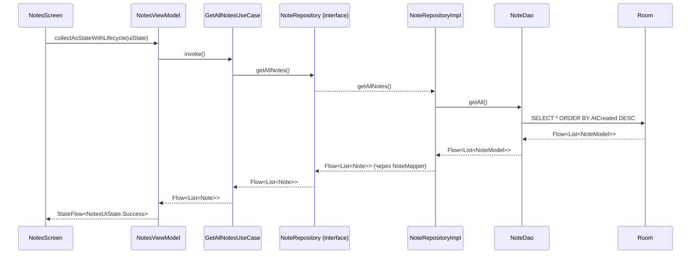
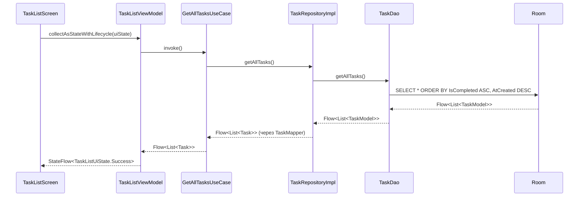
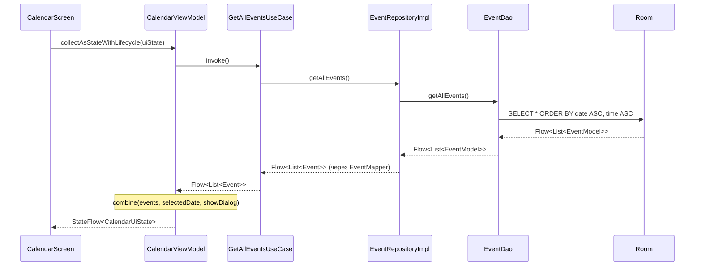
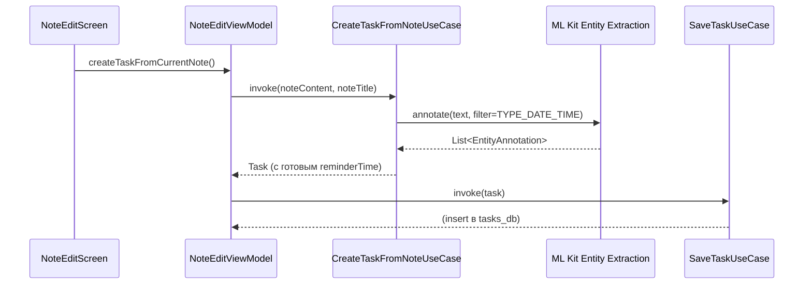

# 🏗 Архитектура PageBook Android

## 🎯 Обзор

PageBook Android следует официальным рекомендациям Google по архитектуре
приложений и использует **Clean Architecture** с тремя слоями:

- **UI Layer** — Compose + ViewModel + UI State.
- **Domain Layer** — Use Cases, доменные модели, интерфейсы репозиториев.
- **Data Layer** — Room, DAO, реализации репозиториев, мапперы.

Внедрение зависимостей — **Hilt** (`@HiltAndroidApp`, `@HiltViewModel`, модули в `data/di/`).

Навигация — **type-safe** на основе `@Serializable` destinations (Navigation Compose 2.8+).

> **Статус миграции:** Clean Architecture полностью внедрена для всех трёх
> модулей — **Notes**, **Tasks** и **Events (Calendar)**. Todos переименованы
> в Tasks и получили связь с заметками через `noteId`.

## 🛠 Технологический стек

| Компонент           | Технология                               | Версия         |
|:--------------------|:-----------------------------------------|:---------------|
| Язык                | Kotlin                                   | 2.2.20         |
| UI                  | Jetpack Compose + Material 3             | BOM 2026.09.00 |
| Архитектура         | Clean Architecture (UI/Domain/Data)      | —              |
| Локальное хранилище | Room                                     | 2.7.2          |
| Асинхронность       | Coroutines & Flow                        | 1.10.2         |
| DI                  | **Hilt**                                 | 2.56.2         |
| Навигация           | Navigation Compose (type-safe)           | 2.9.0          |
| ML                  | **ML Kit Entity Extraction** (beta)      | 16.0.0-beta6   |
| Сборка              | AGP                                      | 9.4.1          |
| SDK                 | compileSdk 37 / targetSdk 36 / minSdk 28 | —              |
| JDK                 | Java 21                                  | —              |

## 📂 Структура пакетов

```
ru.maxgog.pagebook
├── PageBookApplication.kt        # @HiltAndroidApp
├── MainActivity.kt               # enableEdgeToEdge() + setContent { CombinedAppTheme { ... } }
│
├── data/
│   ├── dao/                      # NoteDao, TaskDao, EventDao
│   ├── models/                   # NoteModel, TaskModel, EventModel (@Entity)
│   ├── rooms/                    # NoteRoomDatabase, TaskRoomDatabase, EventRoomDatabase
│   ├── mapper/                   # NoteMapper, TaskMapper, EventMapper
│   ├── repository/               # NoteRepositoryImpl, TaskRepositoryImpl, EventRepositoryImpl
│   └── di/                       # NotesModule, TaskModule, EventModule
│
├── domain/
│   ├── model/                    # Note, Task, Event
│   ├── repository/               # NoteRepository, TaskRepository, EventRepository (интерфейсы)
│   └── usecase/
│       ├── note/                 # GetAllNotesUseCase, SaveNoteUseCase, DeleteNoteUseCase
│       ├── task/                 # GetAllTasksUseCase, SaveTaskUseCase,
│       │                         #   DeleteTaskUseCase, GetTaskByIdUseCase,
│       │                         #   CreateTaskFromNoteUseCase
│       └── event/                # GetAllEventsUseCase, SaveEventUseCase, DeleteEventUseCase
│
└── ui/
├── app/                      # CombinedApp — корневой Composable со Scaffold
├── navigation/               # Destinations.kt, AppNavHost.kt, BottomNavBar.kt
├── notes/                    # NotesScreen, NotesViewModel, NotesUiState
├── note_edit/                # NoteEditScreen, NoteEditViewModel, NoteEditUiState
├── tasks/                    # TaskListScreen, TaskListViewModel, TaskListUiState
│                             #   TaskEditScreen, TaskEditViewModel, TaskEditUiState
│                             #   TaskItem
├── calendar/                 # CalendarScreen, CalendarViewModel, CalendarUiState
├── items/                    # NoteItem, EventItem, (TaskItem — в ui/tasks)
├── dialogs/                  # AddEventDialog, DateTimePickerDialog, AddTodoDialog
└── theme/                    # Color, Type, Theme
```

## 💾 Три независимые базы данных

Проект использует **три отдельные БД** — по одной на модуль:

| БД          | Таблица  | Модуль   | Особенности                                      |
|:------------|:---------|:---------|:-------------------------------------------------|
| `notes_db`  | `notes`  | Notes    | Базовая сущность, к которой привязываются задачи |
| `tasks_db`  | `tasks`  | Tasks    | Содержит колонку `NoteId` + `Index("NoteId")`    |
| `events_db` | `events` | Calendar | `date` (LocalDate) + `time` (String)             |

### ⚠️ Связь Task ↔ Note без ForeignKey

`TaskModel.noteId` — обычная колонка с индексом, **без** `ForeignKey`. Room не
поддерживает внешние ключи между разными БД. Целостность поддерживается на
уровне Use Case: при удалении заметки `DeleteNoteUseCase` обнуляет `noteId`
у связанных задач. Это осознанный компромисс: каскадные операции выполняются
вручную, но модули остаются изолированными.

## 🔄 Поток данных

### Пример 1: список заметок (Notes)



### Пример 2: список задач (Tasks)



**Особенность:** сортировка незавершённых сверху (`IsCompleted ASC`), внутри
группы — новые первыми (`AtCreated DESC`).

### Пример 3: календарь (Events)



**Особенность:** UI-состояние собирается через `combine` трёх источников —
список событий из Flow, выбранная дата и флаг диалога. Фильтрация
«события выбранного дня» выполняется во ViewModel, а не в Composable.

### Пример 4: создание задачи из заметки



**Особенность:** ML Kit извлекает даты из текста заметки и автоматически
заполняет `reminderTime` — пользователю остаётся только подтвердить.

## 🧭 Ключевые архитектурные решения

| Решение                                      | Обоснование                                                                                  |
|:---------------------------------------------|:---------------------------------------------------------------------------------------------|
| **Clean Architecture**                       | UI не зависит от схемы БД; Use Cases инкапсулируют бизнес-логику; легко тестировать.         |
| **Repository как интерфейс**                 | Позволяет подменить источник данных (например, добавить сеть) без изменения Domain/UI.       |
| **UI State (sealed interface / data class)** | Явные состояния `Loading`/`Success`/`Error` — не «дёргающийся» UI и предсказуемое поведение. |
| **Hilt**                                     | Масштабируемый DI, генерируемый на этапе компиляции, интеграция с `@HiltViewModel`.          |
| **Type-safe navigation**                     | Компилятор проверяет маршруты и аргументы; безопасный рефакторинг.                           |
| **`collectAsStateWithLifecycle()`**          | Подписка живёт только пока экран видим — экономия ресурсов.                                  |
| **`contentPadding` в LazyColumn/Grid**       | Правильный edge-to-edge: контент прокручивается под барами.                                  |
| **Три независимые БД**                       | Изоляция модулей: проще миграции, возможность развивать фичи независимо.                     |
| **`noteId` без ForeignKey**                  | Room не поддерживает FK между БД; связь поддерживается через Use Case.                       |
| **`combine` во ViewModel**                   | Множественные источники (список + выбранная дата + флаг) — один `StateFlow`.                 |
| **ML Kit для извлечения дат**                | Не требует ручного ввода; `TYPE_DATE_TIME` покрывает большинство форматов.                   |

## 🧩 Особенности отдельных модулей

### Tasks

- **Связь с заметками** — через `noteId` (nullable). Позволяет создавать
  задачи из заметок и отображать связанные задачи.
- **Сортировка** — незавершённые сверху, новые внутри группы.
- **`TaskEditDestination(taskId: Int?)`** — `null` = новая задача, число =
  редактирование существующей. `taskId` извлекается в ViewModel через
  `SavedStateHandle.get<Int>("taskId")`.

### Calendar

- **Реактивность** — `EventDao.getAllEvents()` возвращает `Flow`, поэтому
  изменения в БД сразу отражаются в UI.
- **Скролл к выбранной дате** — `LaunchedEffect(uiState.selectedDate)`
  автоматически скроллит календарь к месяцу выбранного дня.
- **Фильтрация событий** — во ViewModel через `combine`, UI получает уже
  готовый список `eventsForSelectedDate`.

### Notes

- **Rich Text** — HTML-контент через `richeditor-compose`.
- **Адаптивная сетка** — `StaggeredGridCells.Adaptive(minSize = 160.dp)`.
- **Удаление** — `DeleteNoteUseCase` обнуляет `noteId` у связанных задач.

## 🚀 Планы по развитию

- [x] Внедрить **Hilt** для DI.
- [x] Выделить **Domain Layer** (Use Cases) для Notes.
- [x] Перенести **Tasks** на Clean Architecture + переименовать Todo → Task.
- [x] Перенести **Events (Calendar)** на Clean Architecture.
- [x] Добавить **отдельные Domain-модели** для всех трёх модулей.
- [x] Подключить **ML Kit** для извлечения дат из заметок.
- [ ] Реализовать UI для `CreateTaskFromNoteUseCase` в `NoteEditScreen`.
- [ ] Объединить три БД в одну `PageBookDatabase` с `ForeignKey(Note)`.
- [ ] Настроить **модуляризацию** (feature-модули) для ускорения сборки.
- [ ] Unit-тесты для Use Cases и Repository.
- [ ] Добавить **WorkManager** для напоминаний о задачах.
- [ ] Синхронизация с облаком.

## 📚 Полезные ссылки

- [Guide to App Architecture (Google)](https://developer.android.com/topic/architecture)
- [Now in Android (официальный референс)](https://github.com/android/nowinandroid)
- [Navigation — type safety](https://developer.android.com/guide/navigation/design/type-safety)
- [ML Kit Entity Extraction](https://developers.google.com/ml-kit/language/entity-extraction)
- [Room — Foreign Keys](https://developer.android.com/training/data-storage/room/relationships)